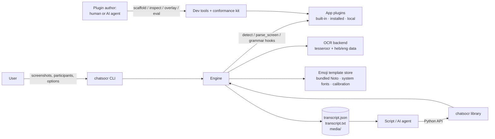
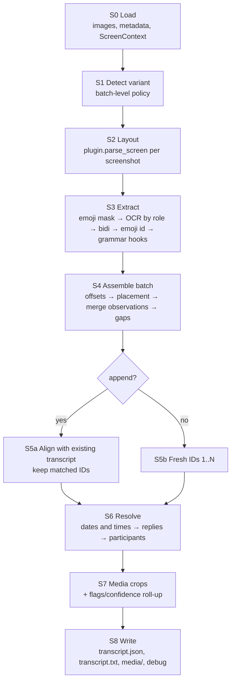
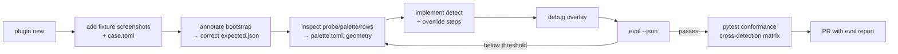

# ChatsOCR: High-Level Design

| | |
|---|---|
| Status | Draft 1, for review |
| Date | 2026-11-24 |
| Related | [Requirements](requirements.md) · [Output format](output-format.md) · [Background research](research/README.md) |

This document describes how ChatsOCR meets the [requirements](requirements.md). Requirement IDs (FR-…, NFR-…) are given where a design element satisfies them. Code blocks are **indicative**: they fix names, responsibilities and data flow, not final signatures.

---

## 1. Design drivers

In priority order:

1. **Extensibility without touching the engine** (FR-PLG-1). A new app, platform, theme or redesign is one new plugin module. The plugin surface must be small, stable and well tooled, so that an AI coding agent can write a plugin from example screenshots.
2. **Correct structure before correct characters.** A misattributed sender, a wrong date or a broken reply link misleads a downstream agent more than a typo does. Layout, ordering and linking get first-class algorithms and tests.
3. **Honest uncertainty.** Every guess is flagged, and the program never blocks when it runs non-interactively (FR-UNC).
4. **Hebrew and English, mixed** (FR-OCR-2). The engine owns text direction; it is never left to the OCR engine.
5. **Local, offline, deterministic, portable** (CON-1/2, NFR-DET-1, NFR-PORT-1).

## 2. Key decisions

| # | Decision | Rationale | Rejected alternatives |
|---|---|---|---|
| D1 | **Python. OpenCV, NumPy and Pillow for vision; Tesseract 5 through `tesserocr` for OCR.** Tesserocr wheels bundle Tesseract 5.5.4, so there is no system install. Language data is `heb+eng`. | Tesseract is the only mature local engine with good Hebrew: in our test, 0–1% character error rate (CER) on Hebrew-only and English-only crops. It runs in-process at about 60–85 ms per crop. It has a permissive license and runs on all three operating systems. See [research](research/ocr-engines.md). | PaddleOCR, EasyOCR, RapidOCR and docTR (no Hebrew); Surya (a vision-language model with restricted weights, too close to "no LLM"); Apple and Windows OCR (no Hebrew, single operating system); cloud OCR (excluded by CON-2) |
| D2 | **The plugin's engine-facing contract is whole-screen: `parse_screen(ctx) -> ScreenLayout`.** Two base classes make it easy to implement: a **step-by-step** one and a **sequential** `crop_next_element` one. | Many decisions need the whole screen: overlays, cut messages, chrome and runs of bubbles. Whole-screen output is easier to test against ground truth. The sequential base keeps the user's mental model as an option. | A per-message iterator as the only contract (errors cascade from one message to the next, and it cannot represent overlays or chrome); pluggy hooks (made for 1:N fan-out, while we need to choose one strategy) |
| D3 | **Plugins handle layout and app-specific grammar. The engine handles everything else:** OCR, text direction, emoji, merging, IDs, dates, replies, media and output. | The generic parts are the hard parts. Writing them once makes plugins short, and every app gets better when the engine improves. | Plugins producing finished messages (duplicated logic, uneven quality) |
| D4 | **Theme is data** (a palette for each variant, with priors and colors re-estimated per screenshot). Platform differences go in subclasses only where the geometry differs. A redesign is a new `ui_epoch` variant. | Avoids writing 3 × 3 × 2 × N classes, yet a dedicated class for one variant is still possible. Users customize themes, so hard-coded colors break. | One class per combination as the default (an explosion of classes); hard-coded hex values |
| D5 | **Parse each screenshot, then merge.** Offsets between screenshots come from **aligning the images** of the masked chat area. Each offset is confirmed by matching at least one message. The final merge works on message observations. | Text-only duplicate removal swallows real repeated messages such as "ok". Stitching the pixels first cannot handle overlays that change between shots, and append mode needs message-level merging anyway. | Stitching the images first; removing duplicates by text alone |
| D6 | **Message IDs are dotted-decimal ordinals that never change** (`5`, `4.1`, `0.2`). | Satisfies the stable-ID requirement for any append (newer, older or in a gap), and agents can still read them. | Renumbering on every append (IDs change); content hashes (collide on repeats, change when OCR improves); fractional-index strings (hard to read) |
| D7 | **JSON (pydantic models plus a generated JSON Schema) is the source of truth. The text view is a deterministic rendering of it.** | The text view uses about a quarter of the tokens of compact JSON for the same conversation. The JSON keeps everything for appends and audits. | Text only (loses provenance and fingerprints); JSON only (expensive in tokens) |
| D8 | **Flag rather than guess. Questions go through a `Resolver` interface.** | One code path serves both interactive and non-interactive runs, and library users can supply their own resolver. | Prompting inside pipeline stages |
| D9 | **Emoji identity comes from matching against templates in the same emoji design as the screenshot.** Templates come from bundled Noto, from emoji fonts on the user's machine, or from a calibration screenshot. | Matching against the same design scored 96–99% top-1 in our test; matching across designs only about 35%. Proprietary designs cannot be shipped. | OCR (reads emoji as junk); always matching against one universal design |
| D10 | **The engine runs its own bidi normalizer, working from word boxes, with an explicit paragraph direction.** | Both OCR engines we tested return logical order, but both misjudge the paragraph direction of some mixed lines. | Trusting the engine's output order; using `python-bidi` (LGPL, and its Rust `get_display` does not mirror brackets) |
| D11 | **All geometry in plugins is written in dp or em** (scale-independent). | One plugin then works for 1080 px, 1170 px and 1440 px wide phones and for desktop zoom levels. | Pixel constants for each resolution |
| D12 | **Plugin discovery:** modules scanned in the built-in `chatsocr.plugins` package, plus the `chatsocr.plugins` entry-point group, plus `--plugin-dir`. Precedence on an ID collision: local > installed > built-in. | Adding a plugin, even a built-in one, is adding a file. No central list needs editing. | A hand-maintained list of built-ins (an edit outside the plugin); namespace packages (fragile) |

---

## 3. Context



Nothing goes over the network during processing (NFR-PRIV-1). The only command that may download anything is the explicit `chatsocr setup`.

## 4. Architecture

### 4.1 Package layout

```
chatsocr/
  plugin_api/       PUBLIC, versioned: IR dataclasses, ChatPlugin, StepwisePlugin, SequentialPlugin,
                    BubbleChatPlugin, VariantKey/VariantSpec/Palette, Detection, DateLabel, MediaInfo,
                    ScreenContext and CvKit protocols, the helper `defaults` module
  cvkit/            Implementation of the CV helpers that plugins use through ctx.cv
  imaging/          Image loading, metadata (EXIF/XMP/file name/mtime), ScreenContext, scale (dp/em)
  registry/         Plugin discovery, validation, availability, detection policy
  ocr/              OcrBackend protocol, TesseractBackend, optional OnnxHebrewBackend, routing by role,
                    preprocessing, BidiNormalizer, OCR cache
  emoji/            Emoji detection and masking, matcher, template store, calibration
  extract/          Turns a ScreenLayout into Observations (runs OCR, emoji, grammar hooks)
  assemble/         Offsets between screenshots, placement, merging observations, gaps
  append/           Aligning a new batch with an existing transcript, allocating IDs
  semantics/        Time anchors, date and time resolution, reply resolution, participant mapping
  media/            Cropping and saving media, perceptual hashes
  model/            pydantic output models, JSON Schema export, flag codes (one enum)
  render/           Text view renderer, reference text-view parser, debug overlays
  interaction/      Resolver protocol: NonInteractive, Terminal, Callback
  pipeline.py       Orchestrator (the stages in §5)
  api.py            Public library API (FR-API)
  cli/              Typer commands: parse, detect, render, plugins, emoji, setup, plugin, inspect, debug, eval, annotate
  devtools/         scaffold, inspect probe/palette/rows/calibrate, overlay, eval, annotate bootstrap
  testing/          Conformance kit (pytest plugin, pytest11 entry point), fixture loader, scoring
  plugins/          Built-in plugins: whatsapp/, telegram/, hinge/ (each a normal plugin, no special access)
  assets/           tessdata (heb, eng), Noto Color Emoji font, JSON Schema
```

**Dependency rule:**
- Plugins import only `chatsocr.plugin_api` (NFR-EXT-1). Built-in plugins follow the same rule, and an import-linter contract in CI enforces it.
- Everything a plugin needs at runtime reaches it through the `ScreenContext` it is given: OCR, the CV helpers and debug drawing.

### 4.2 Main runtime objects

| Object | Owner | Life | Content |
|---|---|---|---|
| `ScreenContext` | imaging | one per screenshot | Pixels, metadata, lazily cached derived data (small copy, palette, em/dp, OCR cache) |
| `ScreenLayout` (IR) | plugin → engine | one per screenshot | Chrome, content area, elements with parts and roles (pixel boxes) |
| `Observation` | extract | one per element per screenshot | Element after OCR, emoji, bidi and grammar: text, times, labels, media info, quote, fingerprint, flags, provenance |
| `ItemCandidate` | assemble | one per item in the batch | Merged observations of one item, with all provenance kept |
| `Transcript` | model | persisted | The output model (output-format §3) |

---

## 5. Processing pipeline



| Stage | Input → output | Owner | Notes |
|---|---|---|---|
| S0 Load | files → `ScreenContext[]` | engine | Apply EXIF orientation, flatten to RGB; read metadata; collect anchor candidates (FR-TIM-4). Unreadable file → `SCREEN_UNPARSEABLE`. |
| S1 Detect | contexts → chosen plugin + variant per screenshot | engine + plugin `detect` | §6.8. May ask through the resolver (FR-DET-4/5). |
| S2 Layout | context → `ScreenLayout` | **plugin** | The only stage that needs app knowledge of pixels. Exceptions are caught and become `PLUGIN_ERROR` (NFR-ROB-1). |
| S3 Extract | layout → `Observation[]` | engine + plugin grammar hooks | §7.5. Relative date labels are resolved here against **this screenshot's** anchor (FR-TIM-3). |
| — Participants | header title + outgoing evidence → participants | engine + resolver | Right after S3 for the first screenshot; asks once if needed (FR-IN-3). |
| S4 Assemble | observations of all screenshots → ordered `ItemCandidate[]` with gap items | engine | §7.6 |
| S5 IDs | candidates (+ existing transcript) → items with IDs | engine | §7.7. Idempotent (FR-MRG-6). |
| S6 Resolve | items → items with dates, times, reply links and senders | engine + plugin hooks | §7.8 and §7.9. Unresolved replies from earlier batches are retried (FR-REP-5). |
| S7 Media | items → crops on disk, hashes | engine | §7.10 |
| S8 Write | transcript → files | engine | Atomic writes: temporary file + rename; `.bak` in append mode. Exit code per FR-CLI-7. |

S0–S3 run **in parallel per screenshot** (§12.1). S4–S8 run once per batch.

---

## 6. Plugin architecture

This section answers the "tricky part" of the request: how a new chat app is supported without changing the engine.

### 6.1 Variants

A **variant** is `VariantKey(app, platform, theme, ui_epoch)`, for example `("whatsapp", "android", "dark", "2024")`.

- A plugin class declares a mapping from the variants it supports to a `VariantSpec`, which holds that variant's data: palette, emoji style, geometry constants and label vocabulary.
- The user's "each app × platform × theme could have its own class" is supported directly: a class whose `variants` holds a single key.
- The common case shares one class across themes (and sometimes platforms). The only difference is the `VariantSpec` data.

### 6.2 The plugin contract (public API, v1)

```python
# chatsocr/plugin_api/__init__.py  (indicative)
from __future__ import annotations

from abc import ABC, abstractmethod
from collections.abc import Iterable, Mapping, Sequence
from dataclasses import dataclass, field
from datetime import date, datetime, time
from enum import StrEnum
from typing import ClassVar, Literal, Protocol

import numpy as np

API_VERSION = 1

BBox = tuple[int, int, int, int]  # x0, y0, x1, y1 in screenshot pixels; origin top-left; x1/y1 exclusive
Platform = Literal["android", "ios", "desktop", "web"]
Theme = Literal["light", "dark"]
Side = Literal["left", "right", "center"]


@dataclass(frozen=True, slots=True)
class VariantKey:
    app: str                      # "whatsapp"
    platform: Platform
    theme: Theme
    ui_epoch: str = "default"     # bump when the app is redesigned, e.g. "2024"


@dataclass(frozen=True, slots=True, kw_only=True)
class Palette:                    # priors; the engine re-estimates actual colors per screenshot
    background: str               # "#0B141A"
    bubble_in: str
    bubble_out: str
    chip: str | None = None
    quote_bar: str | None = None
    time_text: str | None = None
    extra: Mapping[str, str] = field(default_factory=dict)


@dataclass(frozen=True, slots=True, kw_only=True)
class VariantSpec:
    palette: Palette
    emoji_style: str                              # "whatsapp", "apple", "noto", "samsung", ...
    mirrors_in_rtl_ui: bool = True                # WhatsApp: yes; Telegram Android: no
    text_direction_rule: Literal["first_strong", "ui"] = "first_strong"
    shows_message_times: bool = True
    quote_max_lines: int = 2
    locales: tuple[str, ...] = ("en", "he")       # label vocabularies used by the default grammar
    geometry: Mapping[str, float] = field(default_factory=dict)  # named constants in dp, e.g. {"header_h": 56}


@dataclass(frozen=True, slots=True)
class Detection:
    variant: VariantKey
    confidence: float             # 0..1; comparable across plugins thanks to the cross-detection matrix
    evidence: tuple[str, ...] = ()


class ElementKind(StrEnum):
    MESSAGE = "message"
    DATE_SEPARATOR = "date_separator"
    SYSTEM = "system"
    OVERLAY = "overlay"           # floating date pill, scroll button, unread banner, typing indicator, keyboard
    APP_SPECIFIC = "app_specific" # turned into generic items by interpret_app_specific()


class Role(StrEnum):
    BODY = "body"                 # message text or caption
    TIME = "time"
    STATUS = "status"             # ticks, "Sent": evidence of outgoing (P1); markers (P2)
    LABEL = "label"               # text of separators, system lines and overlays
    REPLY_QUOTE = "reply_quote"   # container with QUOTE_* children
    QUOTE_SENDER = "quote_sender"
    QUOTE_TEXT = "quote_text"     # may be a media label such as "Photo" or "Voice message (0:12)"
    QUOTE_THUMB = "quote_thumb"
    MEDIA = "media"               # the visual area of an image, video, sticker or GIF
    MEDIA_INFO = "media_info"     # text in media cards: duration, file name, size, link title or URL
    LINK_PREVIEW = "link_preview" # container
    EMOJI = "emoji"               # jumbo emoji (the engine finds inline emoji itself)
    SENDER_NAME = "sender_name"   # P2 (groups)
    AVATAR = "avatar"             # P2 (groups)
    REACTION = "reaction"         # P2
    MARKER = "marker"             # P2: "edited", "Forwarded", ...


@dataclass(slots=True, kw_only=True)
class Part:
    role: Role | str              # a str role must start with "x-" (plugin-defined)
    bbox: BBox
    children: list[Part] = field(default_factory=list)
    text: str | None = None       # filled in by the engine after OCR; a plugin may pre-fill it
    attrs: dict[str, object] = field(default_factory=dict)
    confidence: float = 1.0


@dataclass(slots=True, kw_only=True)
class Element:
    kind: ElementKind
    bbox: BBox
    side: Side = "center"
    outgoing: bool | None = None  # evidence such as ticks; None = unknown
    parts: list[Part] = field(default_factory=list)
    media_kind: str | None = None # None = text message; "image", "voice", ..., or "x-..."
    subtype: str | None = None    # system / overlay / app-specific subtype
    cut: Literal["none", "top", "bottom"] = "none"
    confidence: float = 1.0
    flags: list[str] = field(default_factory=list)
    extra: dict[str, object] = field(default_factory=dict)


@dataclass(slots=True, kw_only=True)
class ScreenLayout:
    variant: VariantKey
    content_area: BBox
    elements: list[Element]       # in reading order, top to bottom
    chrome: dict[str, BBox] = field(default_factory=dict)  # "status_bar", "header", "composer", "sidebar", ...
    header_title: BBox | None = None   # the contact name in the header (participant inference)
    status_clock: BBox | None = None   # the status-bar clock (anchor cross-check)
    ui_direction: Literal["ltr", "rtl"] = "ltr"
    flags: list[str] = field(default_factory=list)


@dataclass(frozen=True, slots=True, kw_only=True)
class DateLabel:
    kind: Literal["absolute", "month_day", "today", "yesterday", "weekday"]
    value: date | None = None          # kind == "absolute"
    month: int | None = None           # kind == "month_day"
    day: int | None = None
    weekday: int | None = None         # kind == "weekday"; 0 = Monday
    time_of_day: time | None = None    # separators that also show a time (Hinge)


@dataclass(frozen=True, slots=True, kw_only=True)
class MediaInfo:
    kind: str                          # core kind or "x-..."
    attrs: Mapping[str, object] = field(default_factory=dict)  # duration_s, file_name, url, title, ...


@dataclass(slots=True, kw_only=True)
class ItemDraft:                       # generic item produced from an APP_SPECIFIC element
    type: Literal["message", "system"]
    side: Side = "center"
    text: str = ""
    media: list[MediaInfo] = field(default_factory=list)
    subtype: str | None = None


class OcrText(Protocol):
    text: str                          # logical order, NFC
    confidence: float


class CvKit(Protocol):                 # implemented by chatsocr.cvkit; sizes are in em unless named *_px
    def palette(self, box: BBox | None = None, k: int = 8) -> list[tuple[str, float]]: ...
    def color_mask(self, color: str, tol: float = 8.0, box: BBox | None = None) -> np.ndarray: ...
    def flat_regions(self, colors: Sequence[str], *, min_w: float = 1.5, min_h: float = 1.2,
                     tol: float = 8.0, box: BBox | None = None) -> list[BBox]: ...
    def centered_chips(self, box: BBox, *, max_width_ratio: float = 0.7) -> list[BBox]: ...
    def textured_rects(self, box: BBox, *, min_size: float = 3.0) -> list[BBox]: ...
    def small_glyph_cluster(self, box: BBox, corner: Literal["br", "bl", "tr", "tl"]) -> BBox | None: ...
    def quote_bar(self, box: BBox, *, edge: Literal["left", "right"]) -> BBox | None: ...
    def match_icon(self, box: BBox, templates: Mapping[str, np.ndarray],
                   threshold: float = 0.8) -> list[tuple[str, BBox, float]]: ...
    def row_ranges(self, box: BBox, background: str, tol: float = 6.0) -> list[tuple[int, int]]: ...
    def delta_e(self, color_a: str, color_b: str) -> float: ...


class ScreenContext(Protocol):
    image: np.ndarray                  # H×W×3 RGB uint8, read-only
    path: str | None
    filename_tokens: frozenset[str]    # lower-case tokens of the file name, e.g. {"screenshot", "whatsapp"}
    anchor: datetime | None            # capture-time estimate (None during detection if unknown)
    @property
    def small(self) -> np.ndarray: ... # 1/4-scale copy for cheap detection
    @property
    def luminance(self) -> float: ...  # 0..1 mean luminance of the content area estimate
    @property
    def dp(self) -> float: ...         # pixels per dp (estimate)
    @property
    def em(self) -> float: ...         # body-text line height in pixels (estimate)
    @property
    def cv(self) -> CvKit: ...
    def px(self, dp: float) -> int: ...                          # dp → pixels
    def ocr(self, box: BBox, *, role: Role = Role.BODY) -> OcrText: ...  # cached; for layout decisions only
    def debug(self, label: str, box: BBox, note: str = "") -> None: ...  # drawn by `chatsocr debug overlay`


class ChatPlugin(ABC):
    id: ClassVar[str]                                    # "whatsapp.android"
    version: ClassVar[str] = "0.1.0"
    api_version: ClassVar[int] = API_VERSION
    variants: ClassVar[Mapping[VariantKey, VariantSpec]]
    requires: ClassVar[tuple[str, ...]] = ()             # optional import names, e.g. ("onnxruntime",)
    priority: ClassVar[int] = 0

    def __init_subclass__(cls, abstract: bool = False, **kw: object) -> None:
        super().__init_subclass__(**kw)                  # the real version validates metadata unless abstract

    def __init__(self, variant: VariantKey, options: Mapping[str, object] | None = None) -> None:
        self.variant = variant
        self.spec = self.variants[variant]
        self.options = dict(options or {})

    # --- detection (cheap, classmethod, no model loading) ---
    @classmethod
    @abstractmethod
    def detect(cls, ctx: ScreenContext) -> Detection | None: ...

    # --- layout (the core) ---
    @abstractmethod
    def parse_screen(self, ctx: ScreenContext) -> ScreenLayout: ...

    # --- grammar hooks: the engine's defaults cover English and Hebrew; override for app-specific strings ---
    def parse_time(self, text: str) -> time | None: ...
    def parse_date_label(self, text: str) -> DateLabel | None: ...
    def classify_system(self, text: str) -> str | None: ...           # -> subtype, e.g. "encryption_notice"
    def describe_media(self, el: Element) -> MediaInfo: ...           # el.parts[*].text already OCR'd
    def classify_quote(self, quote: Part) -> MediaInfo | None: ...    # "Photo" -> image, "Voice message (0:12)" -> voice
    def quote_sender_is_self(self, text: str) -> bool | None: ...     # "You" / "את/ה" -> True
    def paragraph_direction(self, el: Element, lines: Sequence[str]) -> Literal["ltr", "rtl"] | None:
        return None                                                   # None -> engine rule from spec
    def interpret_app_specific(self, el: Element) -> list[ItemDraft]:
        return [ItemDraft(type="system", text=" ".join(p.text or "" for p in el.parts), subtype=el.subtype)]


class StepwisePlugin(ChatPlugin, abstract=True):
    """Template method: override only the steps your app needs."""

    def parse_screen(self, ctx: ScreenContext) -> ScreenLayout:
        chrome = self.find_chrome(ctx)
        area = self.content_area(ctx, chrome)
        elements: list[Element] = []
        for block in self.find_blocks(ctx, area):
            el = self.classify_block(ctx, block)
            if el is not None:
                self.find_parts(ctx, el)
                elements.append(el)
        layout = ScreenLayout(variant=self.variant, content_area=area, elements=elements, chrome=chrome,
                              ui_direction=self.ui_direction(ctx, elements))
        return self.postprocess(ctx, layout)

    def find_chrome(self, ctx: ScreenContext) -> dict[str, BBox]: ...
    def content_area(self, ctx: ScreenContext, chrome: Mapping[str, BBox]) -> BBox: ...
    def find_blocks(self, ctx: ScreenContext, area: BBox) -> Iterable[BBox]: ...
    @abstractmethod
    def classify_block(self, ctx: ScreenContext, block: BBox) -> Element | None: ...
    def find_parts(self, ctx: ScreenContext, el: Element) -> None: ...
    def ui_direction(self, ctx: ScreenContext, elements: Sequence[Element]) -> Literal["ltr", "rtl"]: ...
    def postprocess(self, ctx: ScreenContext, layout: ScreenLayout) -> ScreenLayout:
        return layout


class SequentialPlugin(StepwisePlugin, abstract=True):
    """The user's model: walk down the screen one element at a time."""

    def parse_screen(self, ctx: ScreenContext) -> ScreenLayout:
        chrome = self.find_chrome(ctx)
        area = self.content_area(ctx, chrome)
        elements: list[Element] = []
        y = area[1]
        while (el := self.crop_next_element(ctx, area, y)) is not None:
            if el.bbox[3] <= y:
                raise RuntimeError("crop_next_element must move downwards")   # the engine reports PLUGIN_ERROR
            elements.append(el)
            y = el.bbox[3]
        layout = ScreenLayout(variant=self.variant, content_area=area, elements=elements, chrome=chrome,
                              ui_direction=self.ui_direction(ctx, elements))
        return self.postprocess(ctx, layout)

    def classify_block(self, ctx: ScreenContext, block: BBox) -> Element | None:
        return None                   # not used by the sequential style

    @abstractmethod
    def crop_next_element(self, ctx: ScreenContext, area: BBox, y: int) -> Element | None: ...
```

**`BubbleChatPlugin(StepwisePlugin)`** is a declarative base in `plugin_api`. It implements *every* step for the common "colored bubbles on a background" layout, driven only by `VariantSpec`:
- palette colors for bubbles and chips;
- `geometry` constants (header and composer heights in dp, time corner, quote-bar edge).

Its default steps:

| Step | Default behaviour |
|---|---|
| `find_chrome` | Rows matched against the expected header and composer heights; uniform horizontal bands |
| `find_blocks` | Flat bubble regions, centered chips and textured rectangles (media), from the CV helpers |
| `classify_block` | **Bubble color + horizontal anchoring:** message on left or right. **Centered chip:** date separator if `parse_date_label` succeeds, otherwise a system line. **Textured rectangle:** media message. **Chip near the top that duplicates a later chip:** overlay. |
| `find_parts` | Time glyph cluster in the trailing bottom corner; quote bar plus tinted block; media rectangle inside the bubble; info text in media cards |
| `ui_direction` | Which side the outgoing evidence (ticks) sits on, when the spec says the app mirrors |

A minimal plugin for a simple app is **metadata, a palette and `detect`** (§6.12). Apps with unusual layouts override single steps, write `parse_screen` themselves, or subclass `SequentialPlugin`.

### 6.3 Mapping the user's `crop_next_message` idea

| User's proposal | Design |
|---|---|
| `crop_next_message(screenshot: np.array, last_message_bottom_pixel_line: int, senders) -> UnparsedMessage` | `SequentialPlugin.crop_next_element(ctx, area, y) -> Element \| None` |
| `screenshot` | `ctx.image`, plus the cached derived data and `ctx.cv` helpers |
| `last_message_bottom_pixel_line` | `y` (the bottom of the previous element) |
| `senders` | Not needed: the plugin returns `side`, and the engine maps sides to participants. In groups (P2) a `SENDER_NAME` part is added. |
| the next message's coordinates and size | `Element.bbox` |
| time of message | a `Part(role=TIME)` box. The engine OCRs it; `parse_time` reads it. |
| sender's name | `Element.side` (plus a `SENDER_NAME` part in P2) |
| emoji reactions' boxes | `Part(role=REACTION)` (P2) |
| reply reference box | `Part(role=REPLY_QUOTE)` with `QUOTE_SENDER`, `QUOTE_TEXT` and `QUOTE_THUMB` children |
| (implicit) date separators, system lines, overlays | also returned as `Element`s with the appropriate `kind`. Returning `None` ends the screen. |

The engine always works with whole-screen `ScreenLayout`s (D2). The sequential base is only a way of writing one. This matters because:
- the engine needs every element at once to merge screenshots, handle cut-off messages and mask overlays;
- tests compare whole element lists against ground truth.

### 6.4 What plugins return: boxes and roles, not finished text

Plugins return **pixel boxes with roles**. The engine reads the text afterwards. This has three benefits:
- OCR quality improves for every plugin at once.
- Plugin authors never deal with bidi or emoji.
- Tests can score layout (box overlap, roles) separately from text.

A plugin may call `ctx.ocr(box)` while building the layout when text decides the layout, e.g. telling a system line from a date chip. Those results are cached and reused.

### 6.5 Grammar hooks

After OCR the engine fills `Part.text` and calls the plugin's grammar hooks to interpret app-specific strings:

| Hook | Called with | Default |
|---|---|---|
| `parse_time` | the TIME part's text | `H:MM`, `HH:MM`, 12-hour with `AM/PM`/`a.m.`/`לפנה״צ`/`אחה״צ`, narrow no-break space |
| `parse_date_label` | separator or overlay label | English and Hebrew vocabularies: Today, Yesterday, היום, אתמול; weekdays in full and abbreviated (`יום א׳`); month names; numeric dates with the transcript's date order |
| `classify_system` | system-line text | Pattern table per locale (encryption notice, missed call, …); otherwise `None` |
| `describe_media` | element with OCR'd `MEDIA_INFO` parts | Uses `media_kind` set during layout, plus duration, size and URL regexes |
| `classify_quote` | `REPLY_QUOTE` part | Media label vocabulary ("Photo", "Video", "Voice message", "Sticker", "GIF", "Document" and Hebrew equivalents) |
| `quote_sender_is_self` | quoted sender text | "You", "את", "אתה", "את/ה" |
| `paragraph_direction` | element and its lines | `None`, meaning the engine applies `spec.text_direction_rule` |
| `interpret_app_specific` | `APP_SPECIFIC` element | One system item made of the element's text |

### 6.6 App-specific elements without engine changes

Elements that have no generic meaning are marked `ElementKind.APP_SPECIFIC` with a `subtype`. The plugin's `interpret_app_specific` turns them into **generic** `ItemDraft`s (FR-PLG-13):
- a system item with text and an `x-…` subtype, or
- a message with `x-…` media kinds and attributes.

Example: Hinge's opening card ("liked your prompt" plus a comment) becomes:

```
1. Bar: <x-hinge-like on=prompt "My simple pleasures" answer="coffee at sunrise"> haha same!
```

Both formats carry `x-` kinds and subtypes without schema changes (output-format §2.4, §3.5). Plugins may also add `x-` roles in parts for their own use.

**Where engine work is still needed.** New *apps* never need engine changes. New *kinds of information* that every app shares, such as reactions or edit markers (P2), are engine features: they are added once, with new roles and output fields, in a minor plugin-API version. Plugins then opt in by emitting the new roles. That is the honest limit of the "no engine changes" goal.

### 6.7 Detection protocol

- `detect` is a **classmethod**. It runs on `ctx.small` and cached features (palette, luminance, band structure, `filename_tokens`), and its budget is ≤ 50 ms (FR-PLG-12). It returns the **variant** it recognized (theme included), so one call covers all of a class's variants.
- **Hints filter first.** `--app/--platform/--theme` remove candidates before scoring. Filename tokens (e.g. Samsung's `_WhatsApp`) add a prior that plugins may read.
- **Batch aggregation.** For each (app, platform), the score is the mean of the best confidences over the screenshots that could be parsed. Theme is chosen per screenshot.
- **Decision policy (FR-DET-3…6):**

  | Situation | Interactive | Non-interactive |
  |---|---|---|
  | top ≥ 0.6 and lead ≥ 0.15 | take it | take it |
  | 0.25 ≤ top, otherwise | ranked choice with the evidence | take the top; flag `DETECTION_AMBIGUOUS` with the alternatives |
  | top < 0.25 | ask which app, from the list of plugins | exit code 3 with a top-3 report |

- **Calibration.** Confidences from different authors become comparable through the conformance kit's **cross-detection matrix** (§10.3): ≥ 0.7 on the plugin's own fixtures, ≤ 0.3 on every other plugin's fixtures. Adding a plugin re-runs the whole matrix, which catches "detection theft".

### 6.8 Discovery, registry and availability

1. **Built-in:** every module under `chatsocr.plugins` (found with `pkgutil.walk_packages`, sorted for determinism).
2. **Installed:** the entry points in group `chatsocr.plugins` (`name = "pkg.module:Class"`, read with `importlib.metadata.entry_points`).
3. **Local:** each `--plugin-dir DIR` and `<user config dir>/chatsocr/plugins/`, loaded with `importlib.util.spec_from_file_location`.

From each module the registry collects the concrete `ChatPlugin` subclasses that:
- are *defined in that module* (`cls.__module__ == module.__name__`),
- are not abstract, and
- have no leading `_` in their name.

This avoids picking up imported base classes and the "last class wins" problem.

- **Validation** at class definition (`__init_subclass__`): the `id` format, `api_version` (the major version must equal the engine's), non-empty `variants`, and valid palette hex values.
- **Availability:** `requires` is checked with `importlib.util.find_spec`. A missing dependency makes the plugin *unavailable (reason)*, as shown by `chatsocr plugins list`. Model files are loaded lazily with `importlib.resources`.
- **Precedence** when two plugins claim the same variant: the more specific class (fewest variants) wins, then local > installed > built-in, then higher `priority`. A collision on `id` logs a warning.
- **Kill switch:** `CHATSOCR_NO_PLUGINS=1` loads built-ins only (NFR-SEC-1).

### 6.9 Versioning the plugin API

- `chatsocr.plugin_api` is the only public surface. It carries a `py.typed` marker and follows semantic versioning on its own `API_VERSION` (major) plus a minor version.
- **Minor** releases only add things: optional fields with defaults, new roles, new hooks with defaults.
- **Removals** first raise `DeprecationWarning` for at least one minor release. The conformance kit runs with `-W error::DeprecationWarning`.
- The engine refuses plugins with a different major version and names the plugin and both versions.

### 6.10 Responsibility split

| Engine | Plugin |
|---|---|
| Loading, metadata, anchors, `ScreenContext`, scale (dp/em) | Chrome and content area |
| Discovery, availability, batch detection policy | `detect` with evidence |
| OCR (routing by role, preprocessing, second backend), NFC, **bidi** | Elements in reading order: kind, side, outgoing evidence, cut |
| **Emoji** detection, masking and identification (template store keyed by `spec.emoji_style`) | Part boxes with roles (body, time, quote…, media, info, jumbo emoji) |
| **Merging screenshots, duplicate removal, gaps** | Overlay elements (so they are masked and dropped) |
| **IDs and append alignment** | Grammar hooks: time, date labels, system subtypes, media and quote labels, "You" |
| **Date and time resolution**, monotonic order checks | App-specific elements → generic items |
| **Reply resolution** (text + thumbnail + sender + media kind) | Variant data: palette priors, geometry in dp, emoji style, mirroring and direction rules |
| Media crops, JSON, text view, flags, interaction | — |

### 6.11 Organizing the phase-1 plugins

```
chatsocr/plugins/
  whatsapp/
    common.py    WhatsAppBase(BubbleChatPlugin, abstract=True): grammar (en/he labels, media and quote labels,
                 system patterns), quote structure, mirrors_in_rtl_ui=True
    android.py   WhatsAppAndroid: variants android × {light, dark} × {epochs}; emoji_style "whatsapp"
    ios.py       WhatsAppIOS: ios × {light, dark}; emoji_style "apple"
    desktop.py   WhatsAppDesktop: {web, desktop} × {light, dark}; emoji_style "whatsapp"
    palette.toml palettes per variant (written by `inspect calibrate`)
  telegram/
    common.py    TelegramBase: date labels (no Yesterday or weekdays; "MMMM d[, yyyy]"), service-message
                 patterns, mirrors_in_rtl_ui=False (Android, verified in source code), emoji_style "apple"
    android.py   ios.py   desktop.py
  hinge/
    common.py    HingeBase: separators that carry times, the "Sent" status label, the opening
                 like/comment card as APP_SPECIFIC, no per-message times, English UI only
    mobile.py    HingeMobile: {android, ios} × {light, dark}; emoji_style "apple" on iOS,
                 "system" on Android (any available template set is tried)
```

The WhatsApp Android plugin is the **reference plugin**. It is fully commented and is what the authoring guide refers to (FR-DEV-7).

### 6.12 A minimal plugin, for scale

```python
# my_plugins/chatty_android.py: a hypothetical simple app (indicative)
from chatsocr.plugin_api import (BubbleChatPlugin, Detection, Palette, VariantKey, VariantSpec)

LIGHT = VariantKey("chatty", "android", "light")
DARK = VariantKey("chatty", "android", "dark")


class ChattyAndroid(BubbleChatPlugin):
    id = "chatty.android"
    version = "0.1.0"
    variants = {
        LIGHT: VariantSpec(palette=Palette(background="#FFFFFF", bubble_in="#F0F0F0", bubble_out="#3D7EFF",
                                           chip="#E4E6EB", time_text="#8A8D91"),
                           emoji_style="noto", geometry={"header_h": 56, "composer_h": 64}),
        DARK: VariantSpec(palette=Palette(background="#000000", bubble_in="#262626", bubble_out="#3D7EFF",
                                          chip="#303030", time_text="#9A9A9A"),
                          emoji_style="noto", geometry={"header_h": 56, "composer_h": 64}),
    }

    @classmethod
    def detect(cls, ctx):
        evidence, score = [], 0.0
        if "chatty" in ctx.filename_tokens:
            score += 0.3
            evidence.append("file name mentions chatty")
        variant = DARK if ctx.luminance < 0.4 else LIGHT
        share = float(ctx.cv.color_mask(cls.variants[variant].palette.bubble_out, tol=6).mean())
        if share > 0.02:
            score += 0.6
            evidence.append(f"outgoing bubble color covers {share:.0%}")
        return Detection(variant, min(score, 1.0), tuple(evidence)) if score else None
```

About 30 lines: every layout step is inherited from `BubbleChatPlugin`, and every grammar hook uses the engine's English and Hebrew defaults. An app with a less regular layout overrides individual steps (`find_parts`, `classify_block`, …) instead.

---

## 7. Engine components

### 7.1 Imaging and `ScreenContext` (S0)

- **Loading.** Pillow: apply the EXIF orientation, convert to RGB `uint8`, composite any alpha over white. JPEG artifacts are expected, so colors are always compared in Lab with a ΔE tolerance (6–10), never exactly.
- **Metadata:** EXIF `DateTimeOriginal`, `OffsetTimeOriginal` and `Software` (including PNG `eXIf`); XMP `DateCreated` (through `defusedxml`); file modification time. File-name patterns:

  | Source | Pattern |
  |---|---|
  | Android (AOSP) | `Screenshot_YYYYMMDD-HHMMSS[_App].png` |
  | Samsung | `Screenshot_YYYYMMDD_HHMMSS_<AppLabel>.jpg` |
  | macOS | `Screenshot YYYY-MM-DD at HH.MM.SS.png` (and the older "Screen Shot") |
  | Windows Snipping Tool | `Screenshot YYYY-MM-DD HHMMSS.png` |
  | Messenger-forwarded copies | `IMG-YYYYMMDD-WA…` gives the transfer date, so it is a low-confidence anchor |

- **Scale.**
  - `dp` starts from the image width and a platform prior (360–440 logical width on phones). Desktop and web use 1.0.
  - `em` is measured lazily as the median text-line height inside the largest flat regions, and refined from OCR line boxes.
  - All CV-helper sizes are in em (D11).
- **Caching.** `small`, `luminance`, the palette clusters (k-means with a fixed seed) and OCR results are computed at most once per context.

### 7.2 OCR subsystem

```python
class OcrBackend(Protocol):
    name: str
    caps: BackendCaps            # languages, levels, text_order ("logical"|"visual"), mirrors_brackets,
                                 # needs_line_crops, supports_whitelist, confidence_calibrated
    def recognize(self, image: np.ndarray, hint: OcrHint) -> OcrResult: ...  # lines → words (bbox, text, conf 0..1)
```

- **Default `TesseractBackend`:**
  - `tesserocr` in-process, with one `PyTessBaseAPI` per worker process and `OMP_THREAD_LIMIT=1`.
  - Bundled `tessdata_fast` `heb+eng` (~5 MB, Apache-2.0); `chatsocr setup --ocr best` installs `tessdata_best`.
  - LSTM engine. Words are read from `GetTSVText` / hOCR. The tesserocr word iterator returns RTL words in visual order, so it is avoided, and a regression test guards this.
  - **Fallback adapter:** `pytesseract`, using a system Tesseract, for platforms without tesserocr wheels.
- **Routing by role** (FR-OCR-7):

  | Role | Mode | Settings |
  |---|---|---|
  | BODY, QUOTE_TEXT | block (page segmentation mode 6) | `heb+eng` |
  | TIME | single line (mode 7) | `eng`; whitelist `0-9:.APMapm`, plus a Hebrew AM/PM pass if the plugin's locale needs it; regex-validated |
  | LABEL, QUOTE_SENDER, MEDIA_INFO | single line | `heb+eng` |

- **Preprocessing:**
  - Crop the part and pad it by 0.3 em using the bubble color.
  - Mask emoji: fill them with the bubble color (§7.4).
  - Convert to grayscale; invert if the background is dark.
  - **Do not binarize.**
  - Upscale with Lanczos only when `em` < 25 px, to a glyph height of about 40 px (this helps desktop/web at 1× zoom).
- **Post-processing:**
  - Strip bidi controls and apply NFC.
  - Run the `BidiNormalizer` (§7.3).
  - Apply small, script-aware fixes (`|` → `I` between Latin letters, geresh/gershayim normalization).
  - Calibrate confidence to 0–1.
- **Second backend (optional, FR-OCR-6):** `OnnxHebrewBackend` (`pip install chatsocr[hebrew-onnx]`).
  - **Used to re-read** lines whose confidence is below τ, or which match known Tesseract failure patterns. One example: a Latin token followed by `-1`, `-n` or `-h` (the `ב-Zoom` → `Zoom-1` failure). Another: a lone short Latin word inside a Hebrew line.
  - **Choosing between the two readings:** confidence, plus agreement with regexes and the lexicon. Both readings are kept in the observation for debugging.
- **Cache.** The key is the crop's hash plus the backend ID, version and hint. It is held in memory per run, plus an optional on-disk cache in the user cache directory (`--no-cache` to disable), which speeds up re-runs and appends.

### 7.3 Bidi normalizer

Input: words with boxes (logical text inside each word), emoji tokens from §7.4, and the element's paragraph direction rule. The steps:

1. If the backend reports visual order, reverse the characters inside each RTL word and mirror its brackets back.
2. Group words into visual lines by y-overlap, and sort each line by x.
3. Classify each word as R (contains Hebrew), L (contains Latin) or N (digits, punctuation, emoji). Mixed tokens like `ב-gym` count as R.
4. **Choose the paragraph direction P**, in this order:
   1. the plugin's `paragraph_direction` hook;
   2. the spec's rule (`first_strong` matches Android, iOS natural alignment and HTML `dir=auto`);
   3. the ragged edge of wrapped lines: text aligned right in its bubble means RTL;
   4. the engine's own guess. If both directions are consistent with the evidence, set `BIDI_AMBIGUOUS`.
5. Apply the inverse of the Unicode bidi algorithm at word level:
   - Neutral words take their neighbours' direction when both neighbours agree; otherwise they take P.
   - Group words into runs, order the runs by P, and order words inside each run by the run's direction.
   - Mirror only `Bidi_Mirrored` characters in RTL runs.
6. Join lines into paragraphs (FR-OCR-3). A visual line break counts as a **hard** break when the line ends more than 1.5 em short of the bubble's maximum text width *and* the next line's first word would have fitted. Otherwise it is a soft wrap.
7. Strip U+200E, U+200F, U+061C, U+202A–U+202E and U+2066–U+2069, apply NFC, and record `dir` = P.

The implementation uses only `unicodedata` (no LGPL dependency). It is tested by rendering logical strings in headless Chromium (`dir=auto`), running OCR and normalization, and asserting that the original string comes back.

### 7.4 Emoji subsystem

- **Detection (before OCR).** Inside BODY, QUOTE_TEXT and LABEL parts:
  - a chroma mask (Lab `√(a²+b²)` > ~15) combined with hue distance from the bubble color;
  - morphological closing, then connected components;
  - keep near-square blobs 0.8–1.5 em tall with solidity > 0.35. The solidity test excludes colored link text.
  - Low-chroma emoji (💀 🖤 ⚪) are caught later: an OCR word with low confidence or junk output is re-tested against the templates.
  - Jumbo emoji come from the plugin as `EMOJI` parts.
- **Masking.** Fill each emoji box with the bubble color before OCR. Insert each emoji as a neutral token at its x position in the visual word sequence, so bidi ordering places it correctly.
- **Identification:**
  - Feature: a Lab image of 24×24 px with absolute color, matched by nearest neighbour.
  - A ±2 px shift search, a two-stage shortlist (color histogram) then verification, and a usage-frequency prior.
  - Confidence comes from the distance and the ratio between the best and second-best matches.
  - Below the threshold the glyph becomes `U+FFFD` with `EMOJI_UNIDENTIFIED`, and the top-3 guesses are kept in `spans[].alternatives`.
  - Supports skin-tone and ZWJ sequences. When a template set lacks a sequence, the app renders it as several glyphs, and the components are output.
- **Template store** (`<user cache>/chatsocr/emoji/<style>/`), keyed by `spec.emoji_style`:
  1. **`noto`:** rendered on first use from the bundled Noto Color Emoji font (OFL), for every fully-qualified sequence in Unicode `emoji-test.txt`.
  2. **`apple`:** on macOS, rendered from the system `Apple Color Emoji` font into the local cache, never redistributed (still to be verified with Pillow sbix rendering).
  3. **Calibration** for any style, required in practice for `whatsapp` and `samsung`, and for `apple` on non-Mac machines:
     1. `chatsocr emoji sheet --top 500` prints numbered rows such as `#012 😀😃😄😁😆😅🤣😂🙂🙃`.
     2. The user sends them to themselves (WhatsApp "Message yourself", Telegram "Saved Messages") and takes screenshots.
     3. `chatsocr emoji calibrate --app whatsapp --platform android shots/` runs the normal pipeline on those screenshots. Because the row content is known, every glyph box can be labelled, and templates are stored per (style, em size).
     4. `chatsocr emoji status` reports coverage.
  4. *P2:* clusters of unknown emoji that the user labels interactively.
- When the variant's style has no templates, all available styles are tried with a confidence penalty (cross-design accuracy is about 35%). The run then prints a one-line hint to calibrate.

### 7.5 Extraction (S3)

For each element of a `ScreenLayout`, the engine:

1. Detects and masks emoji, then OCRs every text role with role routing, then runs bidi normalization, then identifies the emoji. The text is written to `Part.text`.
2. Calls the grammar hooks:
   - `parse_time` → time of day, plus the raw text and OCR alternatives for easily confused digits;
   - `parse_date_label` → `DateLabel`, which is resolved immediately against this screenshot's anchor (§7.8);
   - `classify_system`, `describe_media`, `classify_quote`, `quote_sender_is_self`;
   - `interpret_app_specific` for `APP_SPECIFIC` elements.
3. Computes the quote's thumbnail perceptual hash (pHash) and the media pHashes.
4. Builds the **fingerprint**: side; normalized text (NFC, casefold, collapsed whitespace, emoji kept); time; media kinds and pHashes; quote text.
5. Emits an `Observation` with provenance (screenshot, box, cut), per-field confidences and flags.

Overlay elements produce no observation. A floating date pill is stored as **date evidence** for its screenshot (FR-LAY-3, FR-TIM-1). The header title and status clock are OCR'd once per screenshot.

### 7.6 Batch assembly (S4)

1. **Viewport.** For each screenshot: its content area, with every overlay box masked out.
2. **Pairwise offsets:**
   - Compute row signatures: each viewport row downsampled to 64 Lab columns, weighted by gradient.
   - For every pair and every candidate vertical offset d ∈ [5%, 95%] of the height, compute masked normalized cross-correlation over the overlapping rows. Refine with `cv2.matchTemplate` on a strip about 25% of the height.
   - **Accept** an offset when the peak is ≥ 0.95, it leads the second peak by ≥ 0.03, the overlap is ≥ 2 em, **and** at least one complete observation from each screenshot lands at the same place with compatible content.
   - When the pixel evidence is weak, try a **sequence alignment** of fingerprints (Needleman–Wunsch). This happens, for example, when the keyboard opened or the theme changed. Use it only if it is unambiguous, and flag `OVERLAP_LOW_CONFIDENCE`.
3. **Placement.** Accepted offsets form a graph; each connected component is placed on one y-axis (spanning tree, with a consistency check on cycles). The order of the input files is irrelevant (FR-IN-4).
4. **Clustering observations.** Within a component, observations of the same element are grouped when they:
   - overlap on the global y-axis (IoU ≥ 0.5, or a cut observation contained in a complete one), and
   - have the same kind and side, and compatible fingerprints.

   Two identical "ok" bubbles sit at different global y positions, so they stay separate (FR-MRG-2).
5. **Merging fields** (FR-MRG-4). Each field is taken from the best observation: complete beats cut, then higher confidence. For mutable state (ticks; P2 reactions and markers), the later capture wins. All provenance is kept.
6. **Components and gaps.** With more than one component:
   - Order them by resolved separator dates and message times. Fall back to capture time, then to input order.
   - Insert a `gap` item between components (FR-MRG-3, `GAP_POSSIBLE`).
   - Flag `ORDER_UNCERTAIN` when only capture or input order decided.
7. **Partial-only messages** (seen only cut off) are kept with `PARTIAL_MESSAGE` (FR-LAY-6).

### 7.7 Append and ID allocation (S5)

1. **Load** the existing transcript and check that it is the same chat: app ID, platform, participant labels and sides. A mismatch goes to the resolver, or exit code 5 without `--force` (FR-MRG-7).
2. **Skip known screenshots.** A source whose `sha256` is already listed is skipped, so appending the same files again does nothing (FR-MRG-6).
3. **Assemble** the new batch (§7.6) into a candidate sequence.
4. **Align** it with the existing items: a semi-global alignment that allows the batch to sit before, after or inside the transcript.
   - Similarity: the sides must match; then text ratio (rapidfuzz), equal times, media pHash distance and equal quote text.
   - **Date separators with the same resolved date are strong anchors.**
   - Gap penalties are tuned so that a short run of new messages can be inserted.
5. **Matched items keep their IDs.** New observations are added to their provenance. If the new observation is clearly better (complete instead of cut, higher confidence), its content replaces the old content and a `revisions` entry records the change.
6. **New runs get IDs** by the dotted-decimal rules (output-format §4): the next integers at the end, `P.1…` between neighbours, `0.1…` before the first message.
7. **Weak or no anchoring.** When the batch cannot be anchored, place it using dates and times, insert `gap` items with reason `append_unanchored`, and flag `APPEND_ALIGNMENT_WEAK`.
8. **Retry replies.** Unresolved and ambiguous replies are run through resolution again (FR-REP-5).
9. **Write** a `.bak` copy, then replace the JSON and text atomically.

### 7.8 Date and time resolution (S3 + S6)

- **Anchor for each screenshot** (FR-TIM-4): user, then EXIF with offset, then file-name timestamp, then XMP, then mtime (`ANCHOR_LOW_CONFIDENCE`), then now (`ANCHOR_FALLBACK_NOW`).
  - **Cross-check:** the OCR'd status clock (time of day only) must match the anchor within 2 minutes, otherwise `ANCHOR_CONFLICT`.
  - **Sanity:** the anchor cannot be earlier than the newest "Today" message time shown on that screenshot.
- **Labels, in S3, against the anchor A of the screenshot showing them:**

  | Label kind | Resolves to |
  |---|---|
  | `today` | A |
  | `yesterday` | A − 1 day |
  | `weekday` | the most recent such day strictly before A. Flag if the result is A − 1 or A − 7: an app would normally say "Yesterday" or show a full date. |
  | `month_day` | the latest year that keeps the date ≤ A; set `YEAR_INFERRED` |
  | `absolute` numeric | interpreted with the transcript's date order (FR-TIM-7) |

- **Propagation, in S6, over the final order:**
  - Each message gets its date from the nearest separator above it. Propagation **stops at `gap` items**.
  - Messages above the first separator on a screenshot use that screenshot's floating date pill, if any. Otherwise the date is `null` with `DATE_UNKNOWN`.
  - Separators that carry a time give the following messages that date, but no time.
- **Monotonic walk:**
  - Separator dates must strictly increase. Fix inferred years if needed.
  - (date, time) must never decrease. On a violation, try the OCR alternatives for easily confused digits (1/7, 3/8, 5/6, 0/8). If one restores the order, use it with `TIME_CORRECTED` and keep the raw value; otherwise flag `TIME_NON_MONOTONIC`.

### 7.9 Reply resolution (S6)

**Candidates** are all messages before the reply, in transcript order, including earlier batches.

**Quote normalization:**
- NFKC; strip bidi controls; collapse whitespace; casefold.
- Fold Hebrew final letters (ך→כ etc.) to absorb OCR confusions.
- Turn emoji into tokens.
- Strip a trailing `…` or `...`. The quote is `truncated` if it had one, or if it filled `spec.quote_max_lines`.

**Scores:**

| Score | How it is computed |
|---|---|
| text | truncated quote: `fuzz.ratio(q, cand[:len(q)+3])` (anchored at the start); otherwise `max(ratio, partial_ratio_alignment with start ≈ 0)` |
| media | `classify_quote` gives a media kind. A candidate whose kind is incompatible scores 0. |
| thumbnail | the candidate's media crop, center-cropped to the thumbnail's aspect ratio, both resized to 64×64: 0.4·pHash similarity + 0.3·HSV histogram correlation + 0.3·SSIM (SSIM computed with OpenCV) |
| sender | quote sender → participant (`quote_sender_is_self`, name match). A mismatch is a strong penalty. |
| recency | a small bonus |

**Decision**, with each score normalized to 0–1:

| Condition | Result |
|---|---|
| best ≥ 0.85 and lead ≥ 0.08 | **resolved** |
| best ≥ 0.60 otherwise | **ambiguous**: ranked candidates, `REPLY_AMBIGUOUS` |
| best < 0.60 | **unresolved**: `REPLY_UNRESOLVED` |

- Very short quotes ("ok", one emoji) prefer the nearest earlier exact match, but are always flagged ambiguous.
- If an interactive `--review` answer settles a reply, its `method` includes `user`.

### 7.10 Media (S7)

- Each media part is cropped from the **selected** observation, meaning the most complete one, and saved losslessly as `media/<id>-<n>.png` (FR-MED-4/5).
- Its pHash goes into the JSON for append alignment and reply matching.
- Kinds that have no picture (voice, document, call, …) have `file: null`.
- With `--no-media`, no files are written, but pHashes are still computed.

### 7.11 Uncertainty and interaction

- **Flags** are a single `FlagCode` enum shared by the engine, the JSON Schema and the text renderer (output-format §6). Each flag has `{code, field, confidence?, detail?}`.
- **Confidence roll-up:** field confidences (OCR, time, emoji, reply, side) → item `confidence` = their minimum → transcript `stats`.
- **Resolver:**

```python
class Resolver(Protocol):
    def choose_variant(self, ranked: Sequence[Detection]) -> VariantKey | None: ...
    def confirm_participants(self, proposal: Participants, header_title: str | None) -> Participants: ...
    def confirm_append(self, mismatch: str) -> bool: ...
    def review(self, questions: Sequence[ReviewQuestion]) -> Mapping[str, ReviewAnswer]: ...
```

- **Implementations:**

  | Resolver | Behaviour |
  |---|---|
  | `NonInteractiveResolver` | Applies the policy defaults and never prompts (FR-UNC-3) |
  | `TerminalResolver` | Rich prompts on a terminal |
  | API resolver | Any object the caller passes to `chatsocr.parse(..., resolver=...)` (FR-API-3) |

- **When the pipeline asks:** after S1 (detection), after S3 of the first screenshot (participants), before S5 (append mismatch), and after S6 when `--review` is given (low-confidence replies, emoji and times).
- Answers are recorded with source `user` (FR-UNC-5).

### 7.12 Output (S8)

- **JSON.** pydantic v2 models (`chatsocr.model`) are the only serializer. The JSON Schema is generated from them at build time and shipped in the package.
  - **Determinism:** fixed field order; floats rounded to 2 decimals; `ensure_ascii=False`; arrays always in a defined order; no timestamps except `batches[].processed_at`.
- **Text view.** `render.textview` implements output-format §2 exactly. `render.textview.parse` is the reference parser. A property-based test checks that `parse(render(t))` matches `t` on every field the text view carries.
- **Debug output** (`--debug DIR`):
  - an overlay PNG per screenshot showing elements, parts, roles and the final item IDs;
  - a JSON dump of each stage (layout, observations, placement, alignment);
  - `ctx.debug` annotations added by the plugin.

---

## 8. Interfaces

### 8.1 CLI (Typer)

| Command | Purpose | Requirements |
|---|---|---|
| `chatsocr parse FILES… [options]` | Main run. Options as listed in FR-CLI-1. | FR-CLI-1 |
| `chatsocr detect FILES… [--explain]` | Scores and evidence for every plugin | FR-DET-8 |
| `chatsocr render JSON [--isolate] [--threshold X]` | Regenerate the text view | FR-OUT-6 |
| `chatsocr plugins list` | Registry status | FR-CLI-4 |
| `chatsocr emoji sheet\|calibrate\|status` | Emoji templates | FR-EMO-3 |
| `chatsocr setup [--ocr best] [--hebrew-onnx]` | Explicit download of optional models | FR-CLI-6 |
| `chatsocr plugin new …` | Scaffold a plugin | FR-DEV-1 |
| `chatsocr inspect probe\|palette\|rows\|calibrate` | Numeric inspection tools | FR-DEV-2 |
| `chatsocr debug overlay IMG [--expected]` | Visual check of a plugin's layout | FR-DEV-3 |
| `chatsocr eval --plugin X [--json]` | Score against golden fixtures | FR-DEV-4 |
| `chatsocr annotate bootstrap IMG` | Draft ground truth | FR-DEV-6 |

**Exit codes** follow FR-CLI-7. stderr gets progress output (unless `-q`) and a one-line flag summary. stdout stays clean, so `--stdout text` can pipe the text view.

### 8.2 Python API

```python
import chatsocr

t = chatsocr.parse(
    ["shots/a.png", "shots/b.png"],              # paths, bytes, PIL images or numpy arrays
    participants={"left": "Bar", "right": "Yuval"},
    me="right",                                  # optional
    app=None,                                    # auto-detect; or "whatsapp", or a VariantKey
    captured_at=None,                            # optional override (datetime or per-image mapping)
    output_dir="out/",                           # optional: also write files
    resolver=None,                               # None = non-interactive policy
)
print(t.to_text())                               # text view
t.items[3].reply_to                              # pydantic models
t2 = chatsocr.append(chatsocr.Transcript.load("out/transcript.json"), ["shots/c.png"])
```

The library never prints and never prompts. Warnings are in `t.warnings`, and logging goes through the `chatsocr` logger.

---

## 9. Internal data model

| Model | Key fields |
|---|---|
| `Observation` | `source`, `element_index`, `kind`, `side`, `outgoing`, `cut`, `bbox`, `text`, `dir`, `spans`, `time_raw`, `time` (+ alternatives), `date_label`, `resolved_date`, `media: [MediaInfo + bbox + phash]`, `quote: {sender_text, is_self, text, truncated, media, thumb_phash, bbox}`, `system_subtype`, `fingerprint`, `field_confidence`, `flags` |
| `ItemCandidate` | `observations[]`, `selected` per field, merged fields, `placement_y`, `component` |
| `Transcript` (pydantic) | Exactly output-format §3. Loaded with `Transcript.load()` for append. |

---

## 10. Plugin development workflow (humans and AI agents)

### 10.1 The loop



Agents work from **numbers**: probe values, ΔE, row ranges and the eval diff. The overlay images are for confirmation only (FR-DEV-2). `AGENTS.md` describes this loop step by step. It includes rules taken from mature extractor ecosystems:
- never hard-code pixels, only dp or em;
- never catch-all exceptions inside `detect`;
- keep imports cheap;
- add a fixture for every bug fixed.

### 10.2 Fixtures

```
fixtures/<plugin-id>/<case>/
  01.png 02.png …            screenshots, in any order
  case.toml                  captured_at, participants, ui_lang, expected variant, tolerances, notes
  expected.json              element level: kind, side, bbox, parts (role, bbox, text)
                             item level: id order, text, time, date, media kind, reply target, flags expected
```

- **Synthetic fixtures** from the generator (FR-DEV-8) live in the main repository under `tests/fixtures/`.
- **Real fixtures** (private) live in a separate repository pointed to by `CHATSOCR_FIXTURES`. Tests that need them are skipped when it is not set.
- ID-level expectations use **relative** references (item index), so fixtures do not depend on how IDs are allocated.

### 10.3 Conformance kit (`chatsocr.testing`, pytest plugin)

`parametrize_conformance(PluginCls)` generates checks in the style of scikit-learn's `parametrize_with_checks`:

- **Metadata:** `id`, `version`, `api_version`, variants and palettes are valid; importing is cheap (< 100 ms).
- **Detection:** values are in [0, 1]; results are deterministic; ≤ 50 ms per screenshot; the **cross-detection matrix** holds (≥ 0.7 on the plugin's own fixtures, ≤ 0.3 on every other plugin's).
- **Layout validity:**
  - boxes lie inside the image;
  - elements are in reading order and do not overlap, apart from overlays;
  - parts lie inside their element;
  - roles are valid, and `x-` roles are namespaced.
- **Robustness:** blank, tiny, rotated and unrelated images give no elements or a clean "cannot parse", never an exception.
- **Hygiene:** no network use (sockets blocked); no deprecated API (`-W error::DeprecationWarning`).
- **Known failures:** `expected_failed_checks` documents them.

### 10.4 Scoring (`eval`)

| Level | Metrics |
|---|---|
| Layout | Elements matched with the Hungarian algorithm at IoU ≥ 0.7: precision, recall, F1. Accuracy of kind, side and role. Box overlap for each part. |
| Content | CER on normalized text (rapidfuzz/jiwer); exact time; exact date; media-kind accuracy; reply-target accuracy; emoji top-1 |
| Batch | Duplicate removal: lost and duplicated messages; order errors; gap detection; append idempotency |

Thresholds come from `case.toml`, and default to NFR-ACC-1.
- `--json` writes a machine-readable diff (missing, extra and mismatched elements with boxes; CER per line) for agents.
- Exact text snapshots are not used, because OCR upgrades would break them all.

### 10.5 Quality tiers (authoring checklist)

| Tier | Requirements |
|---|---|
| **Bronze** | Detection, chrome, messages and sides, text, times, date separators, passes conformance |
| **Silver** | Bronze + replies, media placeholders, jumbo and inline emoji (correct `emoji_style`), both themes, overlays, cut messages, Hebrew and English UI where the app has both |
| **Gold** | Silver + all phase-1 media kinds and system subtypes, eval at the NFR-ACC-1 targets on real fixtures, and (P2) reactions and markers |

Phase-1 built-in plugins must reach **Silver**. WhatsApp Android must reach **Gold**.

### 10.6 Synthetic generator

- HTML/CSS templates per variant, rendered by headless Chromium through Playwright. JS collects the boxes of every element and part as ground truth.
- Inputs are scripted conversations in YAML (Hebrew, English and mixed with `dir=auto`; emoji; replies; media placeholders).
- Optional JPEG recompression, scaling and wallpaper noise.
- This data is for unit and regression tests. Accuracy is measured only on real fixtures. The templates approximate each app's look; they do not copy app assets.

---

## 11. Testing strategy

| Layer | What | Where |
|---|---|---|
| Unit | Bidi normalizer (round-trip with Chromium rendering), date-label grammars (en/he), time parsing, ID allocation (property tests: orders are preserved, IDs never collide), reply scoring, fingerprints | `tests/unit` |
| Component | OCR backends on synthetic crops (CER thresholds and versions pinned, tessdata md5 checked); emoji matcher (accuracy on rendered Noto); offset estimation on synthetic scroll sequences, including repeated "ok" bubbles | `tests/component` |
| Plugin | Conformance kit plus golden fixtures for every plugin | `tests/plugins` (synthetic), private fixtures repository (real) |
| End-to-end | The 16 acceptance scenarios in requirements §10 | `tests/e2e` |
| Contract | JSON validates against the schema; text-view grammar round-trip; the reference parser accepts every rendered output | `tests/contract` |
| Extensibility | An **out-of-tree sample plugin** installed through an entry point and loaded through `--plugin-dir`; import-linter (plugins import only `plugin_api`) | `tests/extensibility` |
| Determinism and offline | Run twice and compare; the whole suite with sockets blocked | CI |
| Performance | Benchmarks against NFR-PERF-1/2, reporting regressions | CI (non-blocking) |

---

## 12. Cross-cutting concerns

### 12.1 Performance and concurrency

- **Parallelism:** S0–S3 run in a `ProcessPoolExecutor` with one task per screenshot and workers = cores − 1. Each worker has one long-lived tesserocr instance and `OMP_THREAD_LIMIT=1`.
- **Expected cost per phone screenshot:** detection about 0.1 s for all plugins, layout 0.1–0.3 s, OCR about 25 crops × 60–85 ms ≈ 1.5–2 s on one core, emoji about 0.1 s. That fits NFR-PERF-1, and parallelism helps batches.
- **Memory:** contexts are released after S3, keeping only observations and the media crops that are needed (NFR-PERF-2).

### 12.2 Determinism

- Fixed seeds (`cv2.setRNGSeed`) for k-means.
- Parallel results are re-ordered by input index.
- Ties are broken by stable keys (y, then x, then source index).
- Floats are rounded.
- The discovery order of plugins is sorted.

### 12.3 Errors and robustness

- Plugin calls are wrapped. An exception becomes `PLUGIN_ERROR` with a traceback in the debug output, and the screenshot is skipped.
- A batch in which every screenshot failed exits with code 4.
- An internal engine error exits with code 1, and `--debug` keeps the intermediate results.

### 12.4 Security and privacy

- Plugins are trusted code. Only built-in, installed and explicitly configured directories are loaded (NFR-SEC-1).
- No network use outside `setup` (NFR-PRIV-1).
- Caches (OCR, emoji templates) live in the user cache directory and can be cleared with `chatsocr cache clear`.
- Fixtures with real chats never go into the public repository.

### 12.5 Packaging and dependencies

| Package | License | Use |
|---|---|---|
| numpy, opencv-python-headless (major version pinned) | BSD, Apache-2.0 | arrays and CV |
| Pillow | MIT-CMU | input/output, EXIF, emoji font rendering |
| tesserocr (wheels with Tesseract 5.5.x) | MIT / Apache-2.0 | OCR |
| rapidfuzz | MIT | fuzzy matching |
| pydantic v2 | MIT | output models and schema |
| typer | MIT | CLI |
| defusedxml, platformdirs | PSF, MIT | XMP, user directories |
| *extra `[onnx]` / `[hebrew-onnx]`:* onnxruntime | MIT | plugin models, second OCR backend |
| *extra `[dev]`:* pytest, playwright, jiwer, import-linter, mypy | various permissive | development tools |

- **Assets:** `tessdata_fast` heb and eng (Apache-2.0) and Noto Color Emoji (OFL). All licenses are listed in `THIRD_PARTY.md` (NFR-LIC-1).
- pHash and SSIM are implemented with OpenCV's DCT and filters, which avoids scipy, PyWavelets and scikit-image at runtime.
- Built with `pyproject.toml` and hatchling.
- Python ≥ 3.12.

---

## 13. Risks and mitigations

| Risk | Impact | Mitigation |
|---|---|---|
| Tesseract misreads a Hebrew prefix joined to a Latin word (`ב-Zoom` → `Zoom-1`) | Common words in Israeli chats are wrong | Pattern-triggered re-read with the optional ONNX backend; lexicon post-correction; long term, fine-tune Tesseract `heb` on chat text |
| Accuracy on real screenshots not yet measured (our numbers are from synthetic data) | Targets may be missed | Collect the golden set early (requirements §12); eval in CI; targets revisited after M1 |
| Proprietary emoji designs | Low emoji accuracy without calibration | Calibration flow; Apple font harvesting on macOS; `U+FFFD` plus flag rather than wrong emoji |
| Hinge layout unverified | Plugin design may change | Hinge is last (M4) and needs real samples first; the `APP_SPECIFIC` mechanism absorbs unusual cards |
| App redesigns and user themes | Silent misparsing | `ui_epoch` variants; palette estimated per screenshot; detection must not be confident on unknown layouts (cross-detection matrix); dated fixtures |
| Mirrored RTL UIs | Wrong side mapping | Sides are mapped to participants by the user; outgoing evidence checks `--me`; `ui_direction` recorded |
| Mixed-direction paragraphs that are truly ambiguous | Word order wrong in some single-line bubbles | Plugin rule plus ragged-edge evidence; `BIDI_AMBIGUOUS` flag |
| Repetitive content defeating image alignment | Duplicates or lost messages | Message-level confirmation required for every offset; repeat-preservation acceptance test; flag instead of guessing |
| iOS screenshots without capture metadata | Wrong weekday and "Today" resolution | Status-bar clock, `--captured-at`, `ANCHOR_*` flags |
| Icon templates for detection (ticks, mic) may be app artwork | License concerns | Use procedurally drawn approximations or templates derived from the user's local fixtures at runtime; never ship app assets |
| AI-agent authoring not yet proven | The "dream" may need more tooling | Pilot in M3: an agent writes the Telegram plugins from fixtures and docs alone; every engine change it needs becomes a tracked API gap |
| Rivok ONNX model is young (single maintainer) | Second backend may go stale | Optional extra only; behind the `OcrBackend` interface; pinned model hash |

---

## 14. Roadmap

Phase 1 is delivered in milestones. Each ends with eval reports against the fixtures.

| Milestone | Content | Exit criteria |
|---|---|---|
| **M0 Foundations** | Package skeleton; `plugin_api` v1 (IR, bases, `BubbleChatPlugin`); imaging and metadata; Tesseract backend; bidi normalizer; output models and text renderer/parser; CLI skeleton; devtools (probe, overlay, eval, scaffold); conformance kit; synthetic generator. Golden-set collection starts. | Unit and contract tests pass; out-of-tree sample plugin passes conformance |
| **M1 WhatsApp Android (reference)** | Light and dark, English and Hebrew UI: layout, text, emoji (Noto plus WhatsApp calibration), media, replies, dates; batch merge; append | Gold tier; acceptance scenarios 1–11, 14–16 green |
| **M2 WhatsApp iOS + Desktop/Web** | Remaining WhatsApp variants; Apple emoji style | Silver tier on all WhatsApp variants |
| **M3 Telegram (agent pilot)** | Telegram Android, iOS and Desktop, written by an AI agent following `AGENTS.md` | Silver tier; **zero engine changes** needed by the plugin; API gaps logged and fixed in `plugin_api` minor versions |
| **M4 Hinge** | iOS and Android, opening card through `APP_SPECIFIC`, separators with times | Silver tier on real samples |
| **M5 Hardening** | Calibrate confidences, performance, packaging on three operating systems, documentation, second OCR backend | All P1 Musts done; NFR-ACC targets met or re-baselined with the user |

Later: P2 (group chats, reactions, markers, renumber, HEIC); P3 (GUI, more apps, screen recordings).

---

## 15. Traceability

| Requirement group | Design sections |
|---|---|
| FR-IN | §5 (S0), §7.1, §7.11 (participants), §8 |
| FR-DET | §6.7, §6.8, §8.1 |
| FR-LAY | §6.2–§6.4, §6.11, §7.5 (overlays) |
| FR-OCR | §7.2, §7.3 |
| FR-EMO | §7.4 |
| FR-MED | §6.5, §6.6, §7.10 |
| FR-REP | §7.9, §7.7 step 8 |
| FR-TIM | §7.8, §7.1 (metadata) |
| FR-MRG | §7.6, §7.7, output-format §4 |
| FR-OUT | §7.12, output-format |
| FR-UNC | §7.11, output-format §6 |
| FR-CLI / FR-API | §8 |
| FR-PLG | §6 (all), §4.1 dependency rule |
| FR-DEV | §10 |
| NFR-PRIV / SEC | §3, §12.4 |
| NFR-PERF | §12.1 |
| NFR-DET | §7.12, §12.2 |
| NFR-PORT / LIC | §12.5 |
| NFR-ROB | §12.3 |
| NFR-EXT / MAINT | §6.9, §4.1, §11 |
| NFR-ACC | §10.4, §11, §13 |

---

## Appendix A. Evidence behind the main decisions

All measurements below were taken on **synthetic** WhatsApp-style renders in this project's research spike (2026-11-24). They show direction, not final accuracy. Full reports are in [docs/research/](research/README.md).

**OCR by text crop, character error rate (CER):**

| Engine | English | Hebrew | `נפגש ב-Zoom בשעה 18:30` | Overall (50 crops) | Time crops exact |
|---|---|---|---|---|---|
| Tesseract `heb+eng` | 0–1% | 0% | 17–21% | ~8% | 95–100% |
| Rivok ONNX (cascade) | 0% | 0% | 0% | ~9% (34–41% on English-dominant mixed lines) | 100% |

**Other observations:**

| Observation | Finding |
|---|---|
| Whole-page OCR vs per-crop OCR | Whole page: 40–65% of times exact; per crop: 95–100%. Dark theme without inversion: 44–49% CER. This is why the design OCRs per part. |
| Emoji under OCR | Junk ("@", "©", "טש"). Detecting color blobs: 10/10 found, 0 false positives. With the emoji masked, the rest of the text had 0% CER. |
| Emoji identification, same design | 99.1% top-1 on 40 px glyphs (96.5% with ±1 px box jitter) |
| Emoji identification, across designs | ~35% top-1 |
| Bidi | Both engines return logical order. Both mis-order some LTR-paragraph mixed lines (`WhatsApp שלי לא עובד :(`), so the engine needs its own normalizer. |
| Speed | `tesserocr` in-process: ~60–85 ms per crop. `pytesseract`: ~200 ms per call. |
