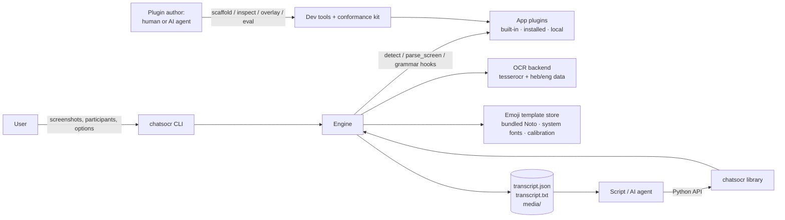
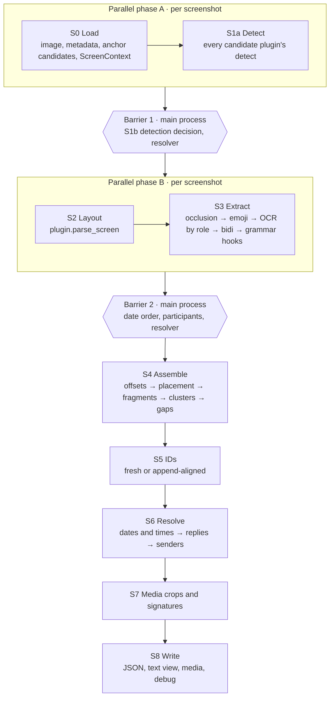
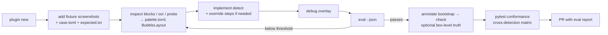

# ChatsOCR: High-Level Design

| | |
|---|---|
| Status | Draft 2, revised after an independent review |
| Date | 2026-11-24 |
| Related | [Requirements](requirements.md) · [Output format](output-format.md) · [Background research](research/README.md) |

This document describes how ChatsOCR meets the [requirements](requirements.md). Requirement IDs (FR-…, NFR-…) appear where a design element satisfies them. Code blocks are **indicative**: they fix names, responsibilities and data flow, not final signatures.

---

## 1. Design drivers

In priority order:

1. **Extensibility without touching the engine** (FR-PLG-1). A new app, platform, theme or redesign is one new plugin module. The plugin surface is small and well tooled, so that an AI coding agent can write a plugin from example screenshots.
2. **Correct structure before correct characters.** A wrongly attributed sender, a wrong date or a wrong reply link misleads a downstream agent more than a typo does. Layout, ordering and linking get first-class algorithms and tests.
3. **Honest uncertainty.** Every guess is flagged, and the program never blocks in non-interactive mode (FR-UNC). If a step can be wrong without saying so, that is a design bug.
4. **Hebrew and English, mixed** (FR-OCR-2). The engine owns text direction; it does not trust the OCR engine with it.
5. **Local, offline, deterministic, portable** (CON-1/2, NFR-DET-1, NFR-PORT-1).

## 2. Key decisions

| # | Decision | Rationale | Rejected alternatives |
|---|---|---|---|
| D1 | **Python. OpenCV, NumPy and Pillow for image processing. Tesseract 5 through `tesserocr`** (its wheels include Tesseract 5.5.4, so nothing else needs installing), with `heb+eng` language data. | Tesseract is the only mature local engine with good Hebrew: 0–1% character error rate (CER) on Hebrew-only and English-only crops in our tests. It runs in-process at about 60–85 ms per crop. It has a permissive license and runs on all three operating systems. See [research](research/ocr-engines.md). | PaddleOCR, EasyOCR, RapidOCR and docTR (no Hebrew); Surya (a vision-language model with restricted weights, too close to "no LLM"); Apple and Windows OCR (no Hebrew, one OS each); cloud OCR (excluded by CON-2) |
| D2 | **The engine sees one plugin contract, whole-screen: `parse_screen(ctx) -> ScreenLayout`.** Two base classes make it easy to write: a **step-by-step** base and a **sequential** base where the author writes only `crop_next_element`. | Several decisions need the whole screen: overlays, cut-off messages, chrome, consecutive bubbles from one sender. Whole-screen output is also easy to test against ground truth. The sequential base keeps the user's own way of thinking available. | A per-message iterator as the only contract (errors cascade, and it cannot represent overlays or chrome); pluggy hooks (made for 1:N fan-out, while we need to pick one strategy) |
| D3 | **Plugins do layout and app-specific grammar. The engine does everything else:** OCR, text direction, emoji, merging, IDs, dates, replies, media and output. | The generic parts are the hard parts. Writing them once keeps plugins short, and every app benefits when the engine improves. | Plugins that produce finished messages (logic duplicated, quality uneven) |
| D4 | **Theme is data:** a palette prior for each variant, re-estimated on every screenshot. Platform differences become subclasses only where the geometry differs. A redesign is a new `ui_epoch` variant. A dedicated class for one variant remains possible. | Avoids writing 3 × 3 × 2 × N classes. Hard-coded colors break, because users customize themes. | One class per combination as the default; hard-coded hex values |
| D5 | **Parse each screenshot, then merge.** Offsets between screenshots come from **image alignment** of the masked chat area (FFT-based), confirmed at message or line level. The final merge works on observations, and joins fragments of a message that is cut off across screenshots. | Text-only de-duplication swallows real repeated messages ("ok", "ok"). Stitching pixels first cannot handle overlays that change between shots. Append mode needs message-level merging anyway. | Stitching images first; text-only de-duplication |
| D6 | **Message IDs are dotted-decimal ordinals that never change** (`5`, `4.1`, `0.2`). The order of the `items` array is authoritative. | Meets the stable-ID requirement for any append (newer messages, older ones, or ones that fill a gap), and agents can still read the IDs. | Renumbering on every append (IDs change); content hashes (collide on repeats, change when OCR improves); fractional-index strings (hard to read) |
| D7 | **JSON is the source of truth** (pydantic models plus a generated JSON Schema). **The text view is a deterministic rendering of it.** | The text view uses about a quarter of the tokens of compact JSON. The JSON keeps everything that append and audit need. | Text only (loses provenance and fingerprints); JSON only (expensive in tokens) |
| D8 | **Flag rather than guess. Questions go through a `Resolver` interface that only the main process calls.** | One code path serves interactive and non-interactive runs, and library users can supply their own resolver. | Prompting from inside pipeline stages or worker processes |
| D9 | **Emoji are identified by matching against templates of the same emoji style.** Templates are stored with transparency (RGBA) and composited onto each query's local background before matching. Sources: bundled Noto, fonts installed on the user's machine, or a calibration screenshot taken in any app that uses the style. | Same-style matching scored 96–99% top-1 in our tests; cross-style matching only about 35%. Templates baked onto one bubble color drop to 45% on other bubble colors. Proprietary emoji sets cannot be shipped. | OCR (reads emoji as junk); one universal template set; opaque templates |
| D10 | **An engine-owned bidi normalizer** rebuilds the text from word boxes. It tests both paragraph directions as hypotheses against pixel evidence and flags ties. | Both OCR engines return logical order, but both get the paragraph direction of some mixed lines wrong. Choosing by the first strong character is circular when the input is visual. | Trusting the OCR engine's order; `python-bidi` (LGPL, and its `get_display` does not mirror brackets) |
| D11 | **Plugin geometry is in dp or em.** The engine estimates the scale from measured text line height, not from image width alone. A plugin can override this with `estimate_scale`. | One plugin then serves 1080/1170/1440 px phones and desktop scaling of 100–200%. | Pixel constants per resolution; a fixed dp of 1.0 on desktop |
| D12 | **Plugin discovery** has three sources: modules under the built-in `chatsocr.plugins` package, the `chatsocr.plugins` entry-point group, and plugin directories (`--plugin-dir`, the user's plugin directory). Every plugin follows one routing and precedence rule (§6.8). | Adding a plugin, even a built-in one, means adding files. No central list needs editing. | A hand-kept list of built-ins; namespace packages |
| D13 | **The plugin API is provisional (0.x) until the M3 agent pilot ends.** Semantic-versioning guarantees start at the first public release. | The pilot exists to find gaps in the API. Freezing the API before it would force a major version bump for every fix. | Freezing a v1 in M0 |

---

## 3. Context



Nothing goes over the network during processing (NFR-PRIV-1). Only the explicit `chatsocr setup` command may download anything.

## 4. Architecture

### 4.1 Package layout

```
chatsocr/
  plugin_api/       PUBLIC: IR dataclasses, ChatPlugin, StepwisePlugin, BubbleChatPlugin, SequentialPlugin,
                    VariantKey/VariantSpec/Palette/Gradient/BubbleLayout/MediaKindSpec, Detection, Scale,
                    DateLabel, MediaInfo, PluginFlag, ScreenContext/CvKit protocols,
                    `defaults` (the engine's default grammar and default layout steps, callable from plugins)
  cvkit/            Implementation of the CV helpers that plugins reach through ctx.cv / ctx.cv_small
  imaging/          Loading, metadata (EXIF/XMP/file name/mtime), ScreenContext, scale estimation
  registry/         Discovery, validation, availability, routing, detection policy
  ocr/              OcrBackend protocol, TesseractBackend, optional OnnxHebrewBackend, routing by role,
                    preprocessing, prefix repair, BidiNormalizer, OCR cache
  emoji/            Detection, segmentation, masking, matcher, RGBA template store, calibration
  extract/          ScreenLayout → Observations (occlusion, OCR, emoji, grammar hooks)
  assemble/         Offsets between screenshots, placement, joining fragments, clustering, gaps
  append/           Alignment with an existing transcript, ID allocation, versions, backups
  semantics/        Anchors, date-order decision, date/time propagation, reply resolution, participants
  media/            Crops, image signatures
  model/            pydantic output models (extra="allow"), JSON Schema export, FlagCode enum
  render/           Text view renderer, reference text-view parser, debug overlays
  interaction/      Resolver protocol: NonInteractive, Terminal, Callback
  config/           Config file loading and precedence (§8.3)
  pipeline.py       Orchestrator with explicit parallel phases and barriers (§5)
  api.py            Public library API (FR-API)
  cli/              Typer commands (§8.1)
  devtools/         scaffold, inspect, overlay, eval, annotate
  testing/          Conformance kit (pytest11 plugin), detection fixture pack, scoring
  plugins/          Built-in plugins: whatsapp/, telegram/, hinge/ (plain plugins, no special access)
  assets/           tessdata (heb, eng), Noto Color Emoji font, JSON Schema
```

**Dependency rule:**
- Plugins import only `chatsocr.plugin_api` (NFR-EXT-1). This applies to built-in plugins too, and an import-linter contract in CI enforces it.
- Everything a plugin needs at runtime comes through the `ScreenContext` it is given (OCR, CV helpers, debug drawing) or through `plugin_api.defaults`.

### 4.2 Main runtime objects

| Object | Owner | Life | Contents |
|---|---|---|---|
| `ScreenContext` | imaging | one per screenshot | Pixels, metadata, hints, scale, and lazily cached derived data |
| `ScreenLayout` (IR) | plugin → engine | one per screenshot | Chrome, content area, elements and overlays with parts and roles (pixel boxes) |
| `Observation` | extract | one per element per screenshot | The element after occlusion, OCR, emoji, bidi and grammar: text lines with y-positions, time, labels, media, quote, signatures, fingerprint, field confidences, flags, provenance |
| `ItemCandidate` | assemble | one per item in a batch | Merged observations of one item, keeping all provenance |
| `Transcript` | model | persisted | The output model ([output-format §3](output-format.md#3-json-transcriptjson)) |

---

## 5. Processing pipeline



| Stage | Input → output | Owner | Notes |
|---|---|---|---|
| S0 Load | files → `ScreenContext` | engine | Apply EXIF orientation and convert to RGB. Read metadata and anchor candidates (FR-TIM-4) and estimate the scale (§7.1). Unreadable file → `SCREEN_UNPARSEABLE`. |
| S1a Detect | context → `Detection` per candidate plugin | plugin `detect` | Runs on the small image (§6.7) |
| S1b Decide | all detections → app, platform; variant per screenshot | engine + resolver | §6.7. **Main process only.** |
| S2 Layout | context → `ScreenLayout` | **plugin** | The only stage that needs app knowledge of pixels. Exceptions become `PLUGIN_ERROR` (NFR-ROB-1). |
| S3 Extract | layout → `Observation[]` | engine + grammar hooks | §7.5. Relative date labels are resolved against **this screenshot's** anchor. Numeric dates stay raw. |
| Barrier 2 | all observations → transcript-level decisions | engine + resolver | Date order (FR-TIM-7) resolves numeric labels. Participants are inferred from every header title and all outgoing evidence (FR-IN-3). Questions go to the resolver. |
| S4 Assemble | observations → ordered `ItemCandidate[]` and gap items | engine | §7.6 |
| S5 IDs | candidates (+ existing transcript) → items with IDs | engine | §7.7. Idempotent (FR-MRG-6). |
| S6 Resolve | items → dates, times, reply links, senders | engine + hooks | §7.8, §7.9. Earlier unresolved replies are retried (FR-REP-5). |
| S7 Media | items → crops and signatures | engine | §7.10 |
| S8 Write | transcript → files | engine | Backups first, then atomic writes (temp file + rename). Exit code per FR-CLI-7. |

**Rule:** the resolver is called only at the barriers and after S6 (`--review`), always from the main process. Workers never prompt and never decide anything for the whole batch.

---

## 6. Plugin architecture

This section answers the "tricky part" of the request: how a new chat app is supported without changing the engine.

### 6.1 Variants

A **variant** is `VariantKey(app, platform, theme, ui_epoch)`, for example `("whatsapp", "android", "dark", "2024")`.

- `platform` and `theme` are open strings. Well-known values are `android`, `ios`, `desktop`, `web`, `light` and `dark`. Plugins may add values such as `ipad`, `macos` or `dark-tinted`. The engine uses only the screenshot's luminance as a light/dark prior.
- A plugin class declares a mapping from each variant it supports to a `VariantSpec`, which holds that variant's data: palette, layout constants, emoji style, and its date and label grammar.
- The user's idea that each app × platform × theme can have its own class is supported directly: a class whose `variants` holds a single key.
- In the common case one class serves several themes, and sometimes several platforms, through `VariantSpec` data alone.

### 6.2 The plugin contract (`chatsocr.plugin_api`, provisional 0.x)

```python
# chatsocr/plugin_api/__init__.py  (indicative; `defaults` and the CvKit implementation are omitted here)
from __future__ import annotations

from abc import ABC, abstractmethod
from collections.abc import Iterable, Mapping, Sequence
from dataclasses import dataclass, field
from datetime import date, datetime, time
from enum import StrEnum
from typing import ClassVar, Literal, Protocol

import numpy as np

from . import defaults  # public: the engine's default grammars and default layout steps

API_VERSION = (0, 1)    # provisional until the first public release (D13)

BBox = tuple[int, int, int, int]  # x0, y0, x1, y1 in FULL-IMAGE pixels; origin top-left; x1/y1 exclusive
Side = Literal["left", "right", "center"]
Direction = Literal["ltr", "rtl"]
Cut = Literal["none", "top", "bottom", "both"]


class PluginContractError(Exception):
    """A plugin broke the contract; the engine reports PLUGIN_ERROR for that screenshot."""


@dataclass(frozen=True, slots=True)
class VariantKey:
    app: str                      # "whatsapp"
    platform: str                 # well-known: android, ios, desktop, web
    theme: str                    # well-known: light, dark
    ui_epoch: str = "default"     # bump when the app is redesigned, e.g. "2024"


@dataclass(frozen=True, slots=True)
class Gradient:
    stops: tuple[str, ...]        # hex colors from top to bottom
    axis: Literal["screen_y", "element_y"] = "screen_y"


Color = str | Gradient


@dataclass(frozen=True, slots=True, kw_only=True)
class Palette:                    # priors; the engine re-estimates actual colors on every screenshot
    background: Color
    bubble_in: Color
    bubble_out: Color
    chip: Color | None = None
    quote_bar: str | None = None
    time_text: str | None = None
    extra: Mapping[str, str] = field(default_factory=dict)


@dataclass(frozen=True, slots=True, kw_only=True)
class BubbleLayout:               # drives BubbleChatPlugin's default steps (§6.3); lengths in dp
    header_h_dp: float
    composer_h_dp: float
    body_line_dp: float = 20.0                    # nominal body line height (scale estimation, §7.1)
    bubble_max_w_dp: float | None = None          # max text width in a bubble (line-break heuristic, §7.3)
    sidebar: Literal["none", "left"] = "none"     # desktop chat list
    column_max_w_dp: float | None = None          # centered message column in wide windows
    avatar_gutter_dp: float = 0.0                 # avatar column beside incoming bubbles
    time_position: Literal["trailing_bottom", "below", "none"] = "trailing_bottom"
    quote_position: Literal["inside", "above"] = "inside"
    quote_bar_edge: Literal["leading", "trailing"] = "leading"     # relative to ui_direction
    separator_style: Literal["chip", "bare_text"] = "chip"
    status_row_below: bool = False                # "Sent"/"Seen" row under the latest outgoing message
    link_preview_bar: bool = False                # link cards have a colored bar (not a reply quote)
    date_header_pins: bool = True                 # a date pill sticks to the top while scrolling


@dataclass(frozen=True, slots=True, kw_only=True)
class VariantSpec:
    palette: Palette
    layout: BubbleLayout | None = None            # required by BubbleChatPlugin; otherwise optional
    emoji_style: str = "noto"                     # "whatsapp", "apple", "noto", "samsung", ...
    mirrors_in_rtl_ui: bool = True                # WhatsApp: True; Telegram Android: False
    shows_message_times: bool = True
    separators: Literal["date", "datetime"] = "date"   # "datetime": separators show a time and may repeat within a day
    date_order: Literal["DMY", "MDY", "YMD"] | None = None   # for numeric dates, when the locale fixes it
    quote_max_lines: int = 2
    locales: tuple[str, ...] = ("en", "he")       # label vocabularies used by `defaults`


@dataclass(frozen=True, slots=True, kw_only=True)
class MediaKindSpec:              # declares a plugin-defined "x-" media kind (FR-MED-2)
    has_picture: bool = False
    attr_order: tuple[str, ...] = ()              # render order of attributes in the text view
    quote_labels: tuple[str, ...] = ()            # reply-quote labels that refer to this kind


@dataclass(frozen=True, slots=True)
class Detection:
    variant: VariantKey
    confidence: float             # 0..1; calibrated by the cross-detection matrix (§10.3)
    evidence: tuple[str, ...] = ()


@dataclass(frozen=True, slots=True)
class Scale:
    dp_px: float                  # pixels per dp
    em_px: float                  # body-text line height in pixels
    confidence: float = 1.0


class ElementKind(StrEnum):
    MESSAGE = "message"
    DATE_SEPARATOR = "date_separator"
    SYSTEM = "system"
    OVERLAY = "overlay"           # subtype is an Overlay value
    APP_SPECIFIC = "app_specific" # converted by interpret_app_specific()


class Overlay(StrEnum):
    DATE_PILL = "date_pill"       # pinned date header; its label is date evidence only
    SCROLL_BUTTON = "scroll_button"
    UNREAD_BANNER = "unread_banner"
    TYPING = "typing"
    KEYBOARD = "keyboard"
    OTHER = "other"


class Role(StrEnum):
    BODY = "body"                 # message text or caption
    TIME = "time"
    STATUS = "status"             # ticks, "Sent", "Seen": evidence of outgoing (P1); delivery state (P2)
    LABEL = "label"               # text of separators, system lines and overlays
    REPLY_QUOTE = "reply_quote"   # container: QUOTE_SENDER, QUOTE_TEXT, QUOTE_THUMB
    QUOTE_SENDER = "quote_sender"
    QUOTE_TEXT = "quote_text"     # may be a media label ("Photo", "Voice message (0:12)")
    QUOTE_THUMB = "quote_thumb"
    MEDIA = "media"               # visual media area; attrs["kind"] when it differs from Element.media_kind
    MEDIA_INFO = "media_info"     # card text; attrs["field"]: "duration", "file_name", "size", "url", "title", ...
    LINK_PREVIEW = "link_preview" # container: MEDIA (thumbnail) + MEDIA_INFO parts
    EMOJI = "emoji"               # jumbo emoji (the engine finds inline emoji itself)
    DECORATION = "decoration"     # recorded but never read, cropped or output (tails, icons, avatars in 1:1)
    SENDER_NAME = "sender_name"   # P2 (groups)
    AVATAR = "avatar"             # P2 (groups); in P1 treated like DECORATION
    REACTION = "reaction"         # P2; in P1 kept in provenance only
    MARKER = "marker"             # P2: "edited", "Forwarded"; in P1 kept in provenance only


class PluginFlag(StrEnum):        # the only flag codes a plugin may set (a subset of output-format §6)
    SIDE_UNCERTAIN = "SIDE_UNCERTAIN"
    MEDIA_KIND_UNCERTAIN = "MEDIA_KIND_UNCERTAIN"
    ELEMENT_UNRECOGNIZED = "ELEMENT_UNRECOGNIZED"
    PARTIAL_MESSAGE = "PARTIAL_MESSAGE"


@dataclass(slots=True, kw_only=True)
class Part:
    role: Role | str              # a str role must start with "x-"
    bbox: BBox
    children: list[Part] = field(default_factory=list)
    text: str | None = None       # filled by the engine after OCR; a plugin may pre-fill it (then no OCR)
    ocr: Literal["block", "line", "time", "none"] | None = None   # None = the role's default (x- roles: "none")
    attrs: dict[str, object] = field(default_factory=dict)
    confidence: float = 1.0


@dataclass(slots=True, kw_only=True)
class Element:
    kind: ElementKind
    bbox: BBox                    # union of ALL visible pieces of the element (quote above, status row, ...)
    anchor_bbox: BBox | None = None   # the main body (the bubble or chip); None = same as bbox
    side: Side = "center"
    outgoing: bool | None = None  # evidence such as ticks; None = unknown
    parts: list[Part] = field(default_factory=list)
    media_kind: str | None = None # None = text message; core kind or "x-..."
    subtype: str | None = None    # system subtype, Overlay value, or app-specific subtype
    pinned: bool | None = False   # date chips only: True = pinned header, None = undecided (engine decides, §7.6)
    cut: Cut = "none"             # which edges may extend beyond the content area
    fill: Color | None = None     # bubble fill if known; otherwise the engine samples it locally
    confidence: float = 1.0       # classification and side confidence
    flags: list[PluginFlag] = field(default_factory=list)
    extra: dict[str, object] = field(default_factory=dict)


@dataclass(slots=True, kw_only=True)
class ScreenLayout:
    variant: VariantKey
    content_area: BBox
    elements: list[Element]       # overlays included; sorted by anchor top, then x
    chrome: dict[str, BBox] = field(default_factory=dict)  # "status_bar", "header", "composer", "sidebar", ...
    header_title: BBox | None = None  # contact name in the header (participant inference)
    status_clock: BBox | None = None  # status-bar clock (anchor cross-check)
    ui_direction: Direction = "ltr"
    flags: list[PluginFlag] = field(default_factory=list)


@dataclass(frozen=True, slots=True, kw_only=True)
class DateLabel:
    kind: Literal["absolute", "numeric", "month_day", "today", "yesterday", "weekday"]
    value: date | None = None              # "absolute": unambiguous dates (month names, ISO)
    numbers: tuple[int, int] | None = None # "numeric": the two day/month numbers in the order shown
    year: int | None = None                # "numeric" / "month_day", when shown
    month: int | None = None               # "month_day"
    day: int | None = None
    weekday: int | None = None             # "weekday"; 0 = Monday
    time_of_day: time | None = None        # separators that show a time


@dataclass(frozen=True, slots=True, kw_only=True)
class MediaInfo:
    kind: str                              # core kind or "x-..."
    bbox: BBox | None = None               # the MEDIA part it describes; None for kinds with no picture
    attrs: Mapping[str, object] = field(default_factory=dict)  # duration_s, file_name, url, title, ...


@dataclass(frozen=True, slots=True)
class Hints:                               # what the user told us (all optional)
    app: str | None = None
    platform: str | None = None
    theme: str | None = None
    ui_lang: str | None = None             # "he" | "en"


class OcrText(Protocol):
    text: str                              # logical order, NFC
    confidence: float


class CvKit(Protocol):
    """Implemented by chatsocr.cvkit. Boxes are always FULL-IMAGE pixels, also on ctx.cv_small (which only
    computes on the 1/4-scale copy). Masks are bool arrays in the frame of the image they were computed on.
    Sizes are in em unless named *_dp."""
    def palette(self, box: BBox | None = None, k: int = 8) -> list[tuple[str, float]]: ...
    def color_mask(self, color: Color, tol: float = 8.0, box: BBox | None = None) -> np.ndarray: ...
    def flat_regions(self, colors: Sequence[Color], *, min_w: float = 1.5, min_h: float = 1.2,
                     tol: float = 8.0, box: BBox | None = None) -> list[BBox]: ...
    def centered_chips(self, box: BBox, *, max_width_ratio: float = 0.7) -> list[BBox]: ...
    def centered_text_lines(self, box: BBox, *, max_width_ratio: float = 0.7) -> list[BBox]: ...
    def textured_rects(self, box: BBox, *, min_size: float = 3.0) -> list[BBox]: ...
    def color_blobs(self, box: BBox, *, min_size: float = 1.5) -> list[BBox]: ...   # stickers, jumbo emoji
    def key_grid(self, box: BBox) -> BBox | None: ...                               # on-screen keyboard
    def small_glyph_cluster(self, box: BBox, corner: Literal["bl", "br", "tl", "tr"]) -> BBox | None: ...
    def quote_bar(self, box: BBox, *, edge: Literal["left", "right"]) -> BBox | None: ...
    def match_icon(self, box: BBox, templates: Mapping[str, np.ndarray],
                   threshold: float = 0.8) -> list[tuple[str, BBox, float]]: ...
    def row_ranges(self, box: BBox, background: Color, tol: float = 6.0) -> list[tuple[int, int]]: ...
    def local_fill(self, box: BBox) -> str: ...                 # dominant color of a ring around box
    def delta_e(self, color_a: str, color_b: str) -> float: ...


class ScreenContext(Protocol):
    image: np.ndarray                      # H×W×3 RGB uint8, read-only
    path: str | None
    filename_tokens: frozenset[str]        # lower-case tokens of the file name, e.g. {"screenshot", "whatsapp"}
    anchor: datetime | None                # capture-time estimate
    hints: Hints
    @property
    def small(self) -> np.ndarray: ...     # 1/4-scale copy
    @property
    def luminance(self) -> float: ...      # 0..1
    @property
    def scale(self) -> Scale: ...
    @property
    def dp(self) -> float: ...             # = scale.dp_px
    @property
    def em(self) -> float: ...             # = scale.em_px
    @property
    def cv(self) -> CvKit: ...
    @property
    def cv_small(self) -> CvKit: ...       # cheap: for detect()
    def px(self, dp: float) -> int: ...
    def ocr(self, box: BBox, *, role: Role = Role.BODY) -> OcrText: ...   # cached; for layout decisions
    def debug(self, label: str, box: BBox, note: str = "") -> None: ...  # drawn by `chatsocr debug overlay`


def _reading_order(el: Element) -> tuple[int, int]:
    box = el.anchor_bbox or el.bbox
    return (box[1], box[0])


class ChatPlugin(ABC):
    id: ClassVar[str]                                    # "whatsapp.android"
    version: ClassVar[str] = "0.1.0"
    api_version: ClassVar[tuple[int, int]] = API_VERSION
    variants: ClassVar[Mapping[VariantKey, VariantSpec]]
    media_kinds: ClassVar[Mapping[str, MediaKindSpec]] = {}
    requires: ClassVar[tuple[str, ...]] = ()             # optional imports, e.g. ("onnxruntime",)
    priority: ClassVar[int] = 0

    def __init_subclass__(cls, abstract: bool = False, **kw: object) -> None:
        super().__init_subclass__(**kw)
        # Real version: unless abstract, validate id, api_version, variants, palettes, layouts, media_kinds.

    def __init__(self, variant: VariantKey, options: Mapping[str, object] | None = None) -> None:
        self.variant = variant
        self.spec = self.variants[variant]
        self.options = dict(options or {})

    # --- detection: cheap classmethod, no model loading ---
    @classmethod
    @abstractmethod
    def detect(cls, ctx: ScreenContext) -> Detection | None: ...

    # --- scale: None means use the engine's estimate (§7.1) ---
    def estimate_scale(self, ctx: ScreenContext) -> Scale | None:
        return None

    # --- layout: the core ---
    @abstractmethod
    def parse_screen(self, ctx: ScreenContext) -> ScreenLayout: ...

    # --- grammar hooks: the engine always calls these; a returned None is final ---
    def parse_time(self, text: str) -> time | None:
        return defaults.parse_time(text, self.spec.locales)

    def parse_date_label(self, text: str) -> DateLabel | None:
        return defaults.parse_date_label(text, self.spec.locales)

    def classify_system(self, text: str) -> str | None:              # -> subtype
        return defaults.classify_system(text, self.spec.locales)

    def describe_media(self, el: Element) -> list[MediaInfo]:        # one per media item; parts already OCR'd
        return defaults.describe_media(el)

    def classify_quote(self, quote: Part) -> MediaInfo | None:       # "Photo" -> image, ...
        return defaults.classify_quote(quote, self.spec.locales, self.media_kinds)

    def quote_sender_is_self(self, text: str) -> bool | None:        # "You", "את/ה"
        return defaults.quote_sender_is_self(text, self.spec.locales)

    def paragraph_direction(self, el: Element, lines: Sequence[str]) -> Direction | None:
        return None                                                  # None -> the engine's hypothesis test

    def interpret_app_specific(self, el: Element) -> list[Element]:  # -> ordinary MESSAGE/SYSTEM elements
        return defaults.app_specific_as_system(el)


class StepwisePlugin(ChatPlugin, abstract=True):
    """Template method. Every step except find_blocks/classify_block has a working default."""

    def parse_screen(self, ctx: ScreenContext) -> ScreenLayout:
        chrome = self.find_chrome(ctx)
        area = self.content_area(ctx, chrome)
        overlays = self.find_overlays(ctx, area)
        elements = self.find_elements(ctx, area, overlays)
        direction = self.ui_direction(ctx, elements)
        for el in elements:
            if not el.parts:
                self.find_parts(ctx, el, direction)
            if el.cut == "none":
                el.cut = self.cut_state(ctx, el, area)
        layout = ScreenLayout(
            variant=self.variant, content_area=area, chrome=chrome, ui_direction=direction,
            elements=sorted([*elements, *overlays], key=_reading_order),
            header_title=self.find_header_title(ctx, chrome),
            status_clock=self.find_status_clock(ctx, chrome),
        )
        return self.postprocess(ctx, layout)

    def find_chrome(self, ctx: ScreenContext) -> dict[str, BBox]:
        return {}

    def content_area(self, ctx: ScreenContext, chrome: Mapping[str, BBox]) -> BBox:
        return defaults.area_between_chrome(ctx, chrome)

    def find_overlays(self, ctx: ScreenContext, area: BBox) -> list[Element]:
        return []

    def find_elements(self, ctx: ScreenContext, area: BBox, overlays: Sequence[Element]) -> list[Element]:
        found = (self.classify_block(ctx, block) for block in self.find_blocks(ctx, area, overlays))
        return [el for el in found if el is not None]

    @abstractmethod
    def find_blocks(self, ctx: ScreenContext, area: BBox, overlays: Sequence[Element]) -> Iterable[BBox]: ...

    @abstractmethod
    def classify_block(self, ctx: ScreenContext, block: BBox) -> Element | None: ...

    def ui_direction(self, ctx: ScreenContext, elements: Sequence[Element]) -> Direction:
        return "ltr"

    def find_parts(self, ctx: ScreenContext, el: Element, direction: Direction) -> None:
        return None

    def cut_state(self, ctx: ScreenContext, el: Element, area: BBox) -> Cut:
        return defaults.cut_from_edges(el, area, ctx.em)

    def find_header_title(self, ctx: ScreenContext, chrome: Mapping[str, BBox]) -> BBox | None:
        return None

    def find_status_clock(self, ctx: ScreenContext, chrome: Mapping[str, BBox]) -> BBox | None:
        return None

    def postprocess(self, ctx: ScreenContext, layout: ScreenLayout) -> ScreenLayout:
        return layout


class BubbleChatPlugin(StepwisePlugin, abstract=True):
    """Every step implemented for 'colored bubbles on a background', driven by spec.palette and spec.layout."""

    def find_chrome(self, ctx: ScreenContext) -> dict[str, BBox]:
        return defaults.bubble.find_chrome(ctx, self.spec)

    def find_overlays(self, ctx: ScreenContext, area: BBox) -> list[Element]:
        return defaults.bubble.find_overlays(ctx, area, self.spec)

    def find_blocks(self, ctx: ScreenContext, area: BBox, overlays: Sequence[Element]) -> Iterable[BBox]:
        return defaults.bubble.find_blocks(ctx, area, overlays, self.spec)

    def classify_block(self, ctx: ScreenContext, block: BBox) -> Element | None:
        return defaults.bubble.classify_block(ctx, block, self.spec, self)

    def ui_direction(self, ctx: ScreenContext, elements: Sequence[Element]) -> Direction:
        return defaults.bubble.ui_direction(ctx, elements, self.spec)

    def find_parts(self, ctx: ScreenContext, el: Element, direction: Direction) -> None:
        defaults.bubble.find_parts(ctx, el, direction, self.spec)

    def find_header_title(self, ctx: ScreenContext, chrome: Mapping[str, BBox]) -> BBox | None:
        return defaults.bubble.header_title(ctx, chrome, self.spec)

    def find_status_clock(self, ctx: ScreenContext, chrome: Mapping[str, BBox]) -> BBox | None:
        return defaults.bubble.status_clock(ctx, chrome)


class SequentialPlugin(BubbleChatPlugin, abstract=True):
    """The user's model: walk down the screen one element at a time. Chrome, overlays, direction, parts and
    cut come from BubbleChatPlugin unless overridden; the author writes detect() and crop_next_element()."""

    def find_elements(self, ctx: ScreenContext, area: BBox, overlays: Sequence[Element]) -> list[Element]:
        elements: list[Element] = []
        y = area[1]
        while (el := self.crop_next_element(ctx, area, y, overlays)) is not None:
            if el.bbox[3] <= y:
                raise PluginContractError("crop_next_element must return an element that ends below y")
            elements.append(el)
            y = el.bbox[3]
        return elements

    @abstractmethod
    def crop_next_element(self, ctx: ScreenContext, area: BBox, y: int,
                          overlays: Sequence[Element]) -> Element | None: ...
```

### 6.3 `BubbleChatPlugin`: the declarative base

`BubbleChatPlugin` implements every layout step for the common "colored bubbles on a background" design. It is driven by `spec.palette` and the typed `spec.layout` (`BubbleLayout`). Because the layout is typed, a misspelled key is a construction error rather than a silent default. The default steps:

| Step | Default algorithm | Fields that drive it |
|---|---|---|
| `find_chrome` | Horizontal bands that match the expected header and composer heights, plus the status and navigation bars (uniform bands at the top and bottom edges). A left sidebar where `sidebar="left"`. | `header_h_dp`, `composer_h_dp`, `sidebar` |
| `content_area` | The area between the chrome. With `column_max_w_dp`, the centered column. | `column_max_w_dp` |
| `find_overlays` | **Keyboard:** `cv.key_grid` below the content. **Pinned date pill:** a chip within 1 em of the content top, `pinned=None` when `date_header_pins`. **Scroll button:** a round icon near the bottom trailing corner that overlaps content. **Unread banner:** a full-width strip. **Typing indicator:** an animated-dots icon template. | `date_header_pins`, palette |
| `find_blocks` | Flat regions in the bubble colors (`flat_regions`, or a shaded-region helper for `Gradient` fills). Centered chips, or centered bare text lines when `separator_style="bare_text"`. Textured rectangles (media without a bubble). Color blobs (stickers and jumbo emoji without a bubble). Areas covered by overlays are excluded. | palette, `separator_style` |
| `classify_block` | **Bubble:** side from horizontal anchoring (left or right edge of the content area or column, allowing for `avatar_gutter_dp`); kind MESSAGE. **Chip:** DATE_SEPARATOR if `parse_date_label(ctx.ocr(chip))` succeeds, otherwise SYSTEM. **Textured rectangle or color blob:** MESSAGE with `media_kind` `image`, `sticker` or a jumbo-emoji EMOJI part, by size and texture. A centered block that matches nothing is SYSTEM with `ELEMENT_UNRECOGNIZED`. | palette, layout |
| `ui_direction` | `rtl` if the outgoing bubble color (`bubble_out`) is on the left, else `ltr`. Only when `mirrors_in_rtl_ui`; otherwise always `ltr`. Computed **before** `find_parts`. | `mirrors_in_rtl_ui` |
| `find_parts` | **TIME/STATUS:** the small glyph cluster in the *trailing* bottom corner (trailing is resolved with `direction`), or a row below the bubble for `time_position="below"`. **REPLY_QUOTE:** quote bar plus tinted block at the top of the bubble on the `quote_bar_edge` side, or the separate faded bubble above for `quote_position="above"`, which is merged into `bbox`. **LINK_PREVIEW:** a card with a thumbnail, title and domain inside a bubble that also contains URL text; with `link_preview_bar`, a colored bar does not make it a quote. **MEDIA** and **MEDIA_INFO** inside the bubble. **STATUS row** below the latest outgoing message when `status_row_below`. | `time_position`, `quote_position`, `quote_bar_edge`, `link_preview_bar`, `status_row_below` |
| `cut_state` | `top`/`bottom`/`both` when the element is within 0.25 em of the content edges. With `quote_position="above"`, also `top` when it starts within 3 em of the top edge, because the quote may be hidden. | `quote_position` |
| `find_header_title` / `find_status_clock` | The largest text line in the header band; the time-shaped glyph cluster in the status bar | — |

A plugin for an app that fits this model is **metadata, a palette, a `BubbleLayout` and `detect`** (§6.12). An app that does not fit overrides individual steps, subclasses `SequentialPlugin`, or writes `parse_screen` itself. Each default step has synthetic conformance fixtures: keyboard, pinned pill, scroll button, link preview, sticker, jumbo emoji, and cut-off elements (§10.3).

### 6.4 Mapping the user's `crop_next_message` idea

| User's proposal | Design |
|---|---|
| `crop_next_message(screenshot: np.array, last_message_bottom_pixel_line: int, senders) -> UnparsedMessage` | `SequentialPlugin.crop_next_element(ctx, area, y, overlays) -> Element \| None` |
| `screenshot` | `ctx.image`, plus its cached derived data and the `ctx.cv` helpers |
| `last_message_bottom_pixel_line` | `y`: the bottom of the previous element |
| `senders` | Not needed. The plugin returns `side`; the engine maps sides to participants. In group chats (P2) a `SENDER_NAME` part is added. |
| next message's coordinates and dimensions | `Element.bbox` (everything that belongs to it) and `Element.anchor_bbox` (the bubble) |
| time of message | A `Part(role=TIME)` box. The engine reads it with OCR and calls `parse_time`. |
| sender's name | `Element.side` (plus a `SENDER_NAME` part in P2) |
| emoji reactions' coordinates | `Part(role=REACTION)` (kept in P1, output in P2) |
| reply reference's coordinates | `Part(role=REPLY_QUOTE)` with `QUOTE_SENDER`, `QUOTE_TEXT` and `QUOTE_THUMB` children |
| (implicit) date separators, system lines | Also returned as `Element`s of the matching `kind`. Returning `None` ends the screen. |
| (implicit) overlays | Found before the walk by `find_overlays` and passed in, so the walk can step over them |

Why the engine always receives a whole `ScreenLayout`:
- the engine needs all elements at once to merge screenshots, handle cut-off messages and mask overlays;
- tests compare whole element lists against ground truth.

The sequential base is a way of *writing* that layout.

### 6.5 What plugins return: boxes and roles, not finished text

Plugins return **pixel boxes with roles**, and the engine reads the text. This has three benefits:
- an OCR improvement helps every plugin;
- authors never deal with text direction or emoji;
- tests can score layout (IoU, roles) separately from text.

A plugin may call `ctx.ocr(box)` during layout when the text decides the layout, for example telling a system line from a date chip. The result is cached and reused.

**Box conventions** (these also govern `expected.json`, §10.2):
1. `Element.bbox` is the union of every visible piece of the element.
2. `anchor_bbox` is the main body: the bubble, the chip, or the media frame. Side, clustering and evaluation matching use `anchor_bbox`.
3. Parts lie inside `bbox`.
4. A status row under a bubble ("Sent", "Seen") is a `STATUS` part of the message above it.
5. Bubble tails and icons that carry no information are `DECORATION`, or are left out.

### 6.6 Grammar hooks and app-specific elements

After OCR, the engine fills `Part.text` and calls the plugin's grammar hooks.
- The defaults live in `plugin_api.defaults` and cover English and Hebrew.
- A plugin extends a default by calling `super()`, or restricts it by returning `None` for strings its app never shows. Example: Telegram has no "Yesterday" or weekday labels.
- The engine always calls the plugin's method, and **`None` is final**.

| Hook | Called with | Default |
|---|---|---|
| `parse_time` | TIME text | `H:MM`, `HH:MM`; 12-hour with `AM/PM`/`a.m.`/`לפנה״צ`/`אחה״צ`; narrow no-break space |
| `parse_date_label` | separator or pill label | Today/Yesterday/היום/אתמול; weekdays in full and abbreviated (`יום א׳`); month-name dates; `numeric` for `DD/MM[/YY]`-style dates, resolved later |
| `classify_system` | system text | Per-locale pattern table (encryption notice, missed call, …); otherwise `None` |
| `describe_media` | element with OCR'd `MEDIA_INFO` parts | One `MediaInfo` per `MEDIA` part (`attrs["kind"]` or `media_kind`), with duration, size and URL from `MEDIA_INFO` parts by `attrs["field"]` |
| `classify_quote` | `REPLY_QUOTE` part | Media label vocabulary (Photo, Video, Voice message, Sticker, GIF, Document, and Hebrew forms) plus each `MediaKindSpec.quote_labels` |
| `quote_sender_is_self` | quoted sender text | "You", "את", "אתה", "את/ה" |
| `paragraph_direction` | element and its lines | `None`: the engine runs its hypothesis test (§7.3) |
| `interpret_app_specific` | `APP_SPECIFIC` element | One SYSTEM element whose text joins the BODY and LABEL parts (never TIME or STATUS) |

**App-specific elements** (FR-PLG-13):
- An element with no generic meaning is marked `APP_SPECIFIC` with a `subtype`.
- `interpret_app_specific` turns it into a list of ordinary `MESSAGE` or `SYSTEM` elements, each with its own parts and boxes. These then go through normal extraction: OCR (skipped for parts whose `text` is pre-filled), media crops and signatures.
- The derived elements keep their list order and are clustered as one group keyed on their parent (§7.6).
- New media kinds are declared in `media_kinds` with `MediaKindSpec`. That declaration says whether the kind has a picture (cropping, signatures), its attribute order in the text view, and which reply-quote labels refer to it.
- Example: Hinge's opening card becomes Bar's message `<x-hinge-like on=prompt prompt="My simple pleasures" answer="coffee at sunrise"> haha same!`.

**Where engine work is still needed.**
- New *apps* never require engine changes.
- New *kinds of information* that every app shares require engine features, added once. Examples are reactions and edit markers (P2): they need new output fields and roles that plugins then start emitting.
- That is the honest boundary of the "no engine change" goal.

### 6.7 Detection protocol and decision policy

- **`detect` is a cheap classmethod.**
  - It runs on `ctx.cv_small` and cached features: luminance, palette, band structure, `filename_tokens`.
  - Budget: ≤ 50 ms per screenshot (FR-PLG-12).
  - It returns the **variant** it recognized, theme included, so one call covers all of a class's variants. Returning `None` means "not mine".
- **App first, then platform** (FR-DET-3…6). Classes that return `None` count as 0 in the means below.

  | Step | What happens |
  |---|---|
  | 1. App score | For each app: the mean, over screenshots, of the best confidence among that app's classes |
  | 2. App decision | **accept** when the top score is ≥ `accept` (0.6) and leads by ≥ `margin` (0.15); **ambiguous** when the top score is ≥ `floor` (0.25); otherwise **none**. Only this step can prompt. |
  | 3. Platform and epoch | Within the chosen app, the highest mean score wins. If the runner-up is within `margin`: `DETECTION_AMBIGUOUS` with the alternatives. No prompt. |
  | 4. Per screenshot | The variant is the `Detection.variant` returned by the routed class (§6.8). A screenshot whose classes all returned `None` takes its theme from luminance and gets `DETECTION_LOW_CONFIDENCE`. |

  | Situation | Interactive | Non-interactive |
  |---|---|---|
  | accept | take it | take it |
  | ambiguous | ranked choice of apps, with evidence | take the top app; `DETECTION_AMBIGUOUS` |
  | none | choose from all installed apps | exit 3 with a report of the top 3 |

- **Hints:**

  | Hint | Effect |
  |---|---|
  | `--app` and `--platform` | Always use those plugins. `DETECTION_MISMATCH` if their mean is below the floor. Never exit 3. |
  | `--app` only | Step 3 among that app's platforms. `DETECTION_MISMATCH` if the best is below the floor. Never exit 3. |
  | `--theme` | Overrides the theme. |
  | `--ui-lang` | Read through `ctx.hints`. Used by the grammar's locale order and as a prior for `ui_direction`. |
  | File-name tokens | A prior that plugins may read. |

### 6.8 Discovery, routing and precedence

**Sources** (D12), found in this order:
1. `chatsocr.plugins.*` (sorted `pkgutil.walk_packages`).
2. Entry points in group `chatsocr.plugins` (`name = "pkg.module:Class"`).
3. Each `--plugin-dir DIR`.
4. `<user config dir>/chatsocr/plugins/`, if the user created it.

**Loading a plugin directory:**
- Each subdirectory with `__init__.py` is imported as a package, under a synthetic name `chatsocr_local_<hash(dir)>.<name>` registered in `sys.modules`. So relative imports (`from .common import …`) and `importlib.resources` (palette files, models) work.
- Each top-level `.py` file is imported as a module under the same namespace.

**Which classes are collected.** From each module, the concrete `ChatPlugin` subclasses that are defined in that module (`cls.__module__ == module.__name__`), are not abstract, and do not start with `_`.

**Validation** happens at class definition:
- the `id` format;
- `api_version`: the same major version as the engine; while provisional, the same `(0, minor)`;
- `variants` is not empty;
- palettes and layouts are valid;
- `x-` kinds are declared in `media_kinds`.

**Availability.** `requires` is checked with `importlib.util.find_spec`. If something is missing, the plugin is *unavailable* and the reason is shown by `chatsocr plugin list`. Models load lazily with `importlib.resources`.

**Routing**, per screenshot:
- Among the classes that **claim the chosen variant** and returned a Detection ≥ floor, the winner is chosen by **precedence**: the more specific class (fewer variants) first, then source (local > installed > built-in), then higher `priority`.
- A class that returned `None` is never routed to.
- With `--app`/`--platform` and no detection at or above the floor, the most specific claiming class is used.

**Precedence for this case:**
- To override one variant of a built-in plugin, a new class with a **new id** declares just that variant.
- Reusing an existing `id` replaces the whole lower-precedence class (with a warning), including the variants only it covered.

**Kill switch.** `CHATSOCR_NO_PLUGINS=1` loads built-in plugins only (NFR-SEC-1).

### 6.9 Versioning

- `chatsocr.plugin_api` is the only public surface, marked `py.typed`.
- **Provisional (0.x) until the M3 agent pilot has finished** (D13). Minor versions may change things, with a changelog. Built-in plugins move along with them.
- **From 1.0, semantic versioning applies:**
  - Minor releases only add: optional fields, roles, hooks with defaults.
  - Removals raise `DeprecationWarning` for at least one minor release first. The conformance kit runs with `-W error::DeprecationWarning`.
  - The engine refuses plugins built for another major version, naming both versions.

### 6.10 Responsibility split

| Engine | Plugin |
|---|---|
| Loading, metadata, anchors, `ScreenContext`, scale estimation | Chrome, content area, optional `estimate_scale` |
| Discovery, availability, routing, batch detection policy | `detect` with evidence |
| Occlusion, OCR (role routing, preprocessing, prefix repair, second backend), NFC, **bidi** | Elements in reading order: kind, side, outgoing evidence, cut, `pinned` |
| **Emoji** detection, segmentation, masking, identification (template store keyed by `spec.emoji_style`) | Part boxes with roles; overlays with `Overlay` subtypes |
| **Screenshot merging, fragment joining, de-duplication, gaps** | Grammar hooks: time, date labels, system subtypes, media and quote labels, "You" |
| **IDs and append alignment**, version checks, backups | App-specific elements → ordinary elements; `x-` kinds declared in `media_kinds` |
| **Date-order decision, date and time resolution, monotonic checks** | Variant data: palette, `BubbleLayout`, emoji style, mirroring, separators, date order |
| **Reply resolution** (stored signatures, quote text, self/other, media kind) | — |
| Media crops, JSON, text view, flags, interaction, configuration | — |

### 6.11 The phase-1 plugins

```
chatsocr/plugins/
  whatsapp/
    common.py    WhatsAppBase(BubbleChatPlugin, abstract=True): en/he labels, media and quote labels,
                 system patterns; mirrors_in_rtl_ui=True; separators="date"
    android.py   WhatsAppAndroid: android × {light, dark} × epochs; emoji_style "whatsapp"
    ios.py       WhatsAppIOS: ios × {light, dark}; emoji_style "apple"
    desktop.py   WhatsAppDesktop: {web, desktop} × {light, dark}; emoji_style "whatsapp"; sidebar="left"
    palette.toml per-variant palettes (written by `inspect calibrate`)
  telegram/
    common.py    TelegramBase(BubbleChatPlugin, abstract=True): date labels "MMMM d[, yyyy]" only
                 (parse_date_label returns None for "Yesterday"/weekdays), service-message patterns,
                 mirrors_in_rtl_ui=False (Android, verified in source), emoji_style "apple"
    android.py   ios.py (outgoing bubble_out is a Gradient in dark)   desktop.py (column_max_w_dp, sidebar)
  hinge/
    common.py    HingeBase(BubbleChatPlugin, abstract=True): separators="datetime", shows_message_times=False,
                 status_row_below=True ("Sent"), opening like/comment card as APP_SPECIFIC → x-hinge-like
    mobile.py    HingeMobile: {android, ios} × {light, dark}; emoji_style "apple" (iOS) / "system" (Android)
```

The WhatsApp Android plugin is the **reference plugin**: fully commented, and the one the authoring guide refers to (FR-DEV-7).

### 6.12 A minimal plugin, for scale

```python
# my_plugins/chatty_android.py: a hypothetical app that fits BubbleChatPlugin (indicative)
from chatsocr.plugin_api import BubbleChatPlugin, BubbleLayout, Detection, Palette, VariantKey, VariantSpec

LIGHT = VariantKey("chatty", "android", "light")
DARK = VariantKey("chatty", "android", "dark")
LAYOUT = BubbleLayout(header_h_dp=56, composer_h_dp=64, body_line_dp=20, bubble_max_w_dp=280)


class ChattyAndroid(BubbleChatPlugin):
    id = "chatty.android"
    version = "0.1.0"
    variants = {
        LIGHT: VariantSpec(palette=Palette(background="#FFFFFF", bubble_in="#F0F0F0", bubble_out="#3D7EFF",
                                           chip="#E4E6EB", time_text="#8A8D91"),
                           layout=LAYOUT, emoji_style="noto"),
        DARK: VariantSpec(palette=Palette(background="#000000", bubble_in="#262626", bubble_out="#3D7EFF",
                                          chip="#303030", time_text="#9A9A9A"),
                          layout=LAYOUT, emoji_style="noto"),
    }

    @classmethod
    def detect(cls, ctx):
        evidence, score = [], 0.0
        if "chatty" in ctx.filename_tokens:
            score += 0.3
            evidence.append("file name mentions chatty")
        variant = DARK if ctx.luminance < 0.4 else LIGHT
        share = float(ctx.cv_small.color_mask(cls.variants[variant].palette.bubble_out, tol=6).mean())
        if share > 0.02:
            score += 0.6
            evidence.append(f"outgoing bubble color covers {share:.0%} of the screen")
        return Detection(variant, min(score, 1.0), tuple(evidence)) if score else None
```

About 30 lines. Every layout step is inherited from `BubbleChatPlugin`, and every grammar hook uses the English and Hebrew defaults. An app that fits less well overrides individual steps.

---

## 7. Engine components

### 7.1 Imaging, metadata and scale (S0)

- **Loading:**
  - Pillow; apply EXIF orientation; RGB `uint8`; composite alpha over white.
  - Colors are compared in CIE Lab with a ΔE tolerance (6–10), never exactly, because of JPEG artifacts.
- **Metadata:**
  - EXIF `DateTimeOriginal`, `OffsetTimeOriginal` and `Software` (including PNG `eXIf`).
  - XMP `DateCreated` (read with `defusedxml`).
  - The file's modification time.
  - File-name patterns:

    | Source | Pattern |
    |---|---|
    | Android (AOSP) | `Screenshot_YYYYMMDD-HHMMSS[_App].png` |
    | Samsung | `Screenshot_YYYYMMDD_HHMMSS_<AppLabel>.jpg` |
    | macOS | `Screenshot YYYY-MM-DD at HH.MM.SS.png` (and the older "Screen Shot") |
    | Windows Snipping Tool | `Screenshot YYYY-MM-DD HHMMSS.png` |
    | Messenger-forwarded | `IMG-YYYYMMDD-WA…`: the transfer date, low confidence |

- **Scale** (D11):
  1. Estimate `em` from the **row profile** of the content area: the median height of text-line runs. This needs no bubble detection.
  2. `dp` = `em / spec.layout.body_line_dp`, snapped to {1, 1.25, 1.5, 1.75, 2, 2.5, 2.625, 2.75, 3, 3.5}.
  3. On phones, cross-check `dp` against the width prior (360–440 logical px).
  4. `plugin.estimate_scale` may override both, for example by measuring the header against its height in dp.

  Before detection, a generic estimate is used. The routed plugin's spec refines it in phase B.
- **Caching.** The small image, luminance, palette clusters (k-means with a fixed seed) and OCR results are computed at most once per screenshot.

### 7.2 OCR subsystem

```python
class OcrBackend(Protocol):
    name: str
    caps: BackendCaps            # languages, levels, text_order ("logical"|"visual"), mirrors_brackets,
                                 # needs_line_crops, supports_whitelist, confidence_calibrated
    def recognize(self, image: np.ndarray, hint: OcrHint) -> OcrResult: ...  # lines → words (bbox, text, conf 0..1)
```

- **Default `TesseractBackend`:**
  - Runs `tesserocr` in-process: one `PyTessBaseAPI` per worker, `OMP_THREAD_LIMIT=1`.
  - Bundles `tessdata_fast` `heb+eng` (~5 MB, Apache-2.0). `chatsocr setup --ocr best` installs `tessdata_best`.
  - Words are read from the TSV/hOCR output. The tesserocr word iterator returns RTL words in visual order, so it is avoided, and a regression test guards this.
  - Fallback adapter: `pytesseract` with a system Tesseract, for platforms without tesserocr wheels.
- **Routing by role** (FR-OCR-7):

  | Role | Mode | Languages and settings |
  |---|---|---|
  | BODY, QUOTE_TEXT, MEDIA_INFO (multi-line) | block (page segmentation mode 6) | `heb+eng` |
  | TIME | single line (mode 7) | `eng`, plus a Hebrew AM/PM pass if the locale needs it. Whitelist `0-9:.APMapm`, validated with a regex. |
  | LABEL, QUOTE_SENDER, single-line MEDIA_INFO | single line | `heb+eng` |
  | `x-` roles | per `Part.ocr` (default `none`) | — |

- **Preprocessing:**
  1. Crop the part. Pad 0.3 em with the **local fill**, a ring of pixels sampled around the part, so gradient bubbles work.
  2. Mask emoji (§7.4).
  3. Convert to grayscale; invert if dark. **Do not binarize.**
  4. Upscale with Lanczos only when `em` < 25 px, to about 40 px glyph height.
- **Occlusion:**
  - Before reading, the engine intersects overlay boxes with part boxes.
  - Occluded parts are read but marked `occluded`. Their fields rank like cut-off fields in §7.6.
  - An occluded TIME part is never parsed: `TIME_UNREADABLE` unless another observation has it.
- **Post-processing:**
  - Strip bidi controls, then NFC.
  - **Prefix repair:** a Latin token followed by `-1`, `-n` or `-h` inside a Hebrew line is the `ב-Zoom` → `Zoom-1` failure. Re-read the single glyph next to the hyphen with `heb` in single-character mode, whitelisted to `בהוכלמש`. If confident, rebuild the token as `ב-Zoom`; otherwise flag `OCR_LOW_CONFIDENCE`.
  - Run the `BidiNormalizer` (§7.3).
  - Apply small script-aware fixes: `|` → `I` between Latin letters; geresh and gershayim.
  - Calibrate confidences to 0–1.
- **Second backend (optional, FR-OCR-6).** `OnnxHebrewBackend` (`chatsocr[hebrew-onnx]`) re-reads lines whose confidence is below τ, or that still match known failure patterns after prefix repair. The reading with higher confidence and better regex/lexicon agreement wins. Both readings are kept for debugging.
- **Cache.** Keyed by crop hash + backend id/version + hint. Held in memory, plus an optional on-disk cache in the user cache directory (`--no-cache`, `chatsocr cache clear`).

### 7.3 Bidi normalizer

**Input:**
- words with boxes (each word's characters already in logical order);
- emoji tokens (§7.4);
- the bubble's text-area box;
- `spec.layout.bubble_max_w_dp`.

**Steps:**
1. If the backend reports visual order, reverse the characters of each RTL word and mirror its brackets.
2. Group words into visual lines by y-overlap, and sort each line by x.
3. Classify each word as R (contains Hebrew), L (contains Latin) or N (digits, punctuation, emoji). Mixed tokens like `ב-gym` count as R.
4. **Paragraph direction as a hypothesis test:**
   1. If the plugin's `paragraph_direction` returns a value, use it.
   2. Otherwise build **both** logical strings, for P = LTR and P = RTL (step 5 run both ways). Keep the hypotheses that agree with the first-strong-character rule. Android, iOS natural alignment and HTML `dir=auto` all use it.
   3. If exactly one agrees, use it.
   4. If both agree, look at pixel evidence:
      - **Ragged edge:** on wrapped lines, the alignment against the bubble edges.
      - **Trailing neutrals:** with P = LTR, punctuation and emoji that end the text sit at the right end; with RTL, at the left.
      - **Line-end gaps:** the gap at each line's end side.
   5. If the evidence is still tied, pick the direction of the line's majority script by character count and set `BIDI_AMBIGUOUS`.
5. **Inverse of the Unicode bidi algorithm, at word level:**
   - A neutral takes its neighbours' direction when both neighbours agree; otherwise it takes P.
   - Group words into runs, order the runs by P, and order the words inside each run by the run's direction.
   - Mirror only `Bidi_Mirrored` characters in RTL runs.
6. **Hard or soft line breaks** (FR-OCR-3), using the reference width W = `bubble_max_w_dp` (for captions, the media width):
   - **Hard:** the bubble is narrower than W minus one word (the sender's own break made it narrow); or a line's end-side gap is more than 1.5 em *and* the next line's first word would have fitted.
   - **Soft:** the line's end-side gap is smaller than the next line's first word plus one space.
   - **Otherwise uncertain:** keep the newline and set `LINEBREAK_UNCERTAIN`.
   - The end side is taken from P.
7. Strip U+200E, U+200F, U+061C, U+202A–U+202E and U+2066–U+2069. Apply NFC. Remove trailing spaces from each line. Record `dir` = P.

Only `unicodedata` is used, so there is no LGPL dependency. Tests render logical strings in headless Chromium (`dir=auto`), including single-line L…R and R…L cases, and assert that the original string comes back or that `BIDI_AMBIGUOUS` is set.

### 7.4 Emoji subsystem

**Detection** (before OCR, in BODY, QUOTE_TEXT and LABEL parts):
1. Build a chroma mask (Lab `√(a²+b²)` > ~15) combined with hue distance from the **local fill**. Close it morphologically with a radius of at most 0.03 em, then take connected components.
2. **Segment runs:** a blob wider than tall is split by vertical projection minima, using the expected advance (≈ glyph height) and allowing aspect ratios of *k* glyphs. This handles 😂😂😂.
3. Keep glyphs 0.6–1.5 em tall with solidity > 0.35. The solidity test excludes colored link text.
4. **Low-chroma emoji** (💀 🖤 ⚪): an OCR "word" that is near-square, about 1 em in size, and non-alphanumeric or below 0.5 confidence is re-tested against templates.
5. Jumbo emoji come from plugins as `EMOJI` parts.

**Masking.** Fill each glyph box with the local fill before OCR. Insert the emoji as an N token at its x position in the visual word sequence.

**Identification:**
1. The query is composited with its own local background. Each **RGBA template** is composited onto that same background before comparing (D9).
2. Feature: 24×24 Lab, absolute color, nearest neighbour.
3. Search ±2 px shifts. Shortlist by color histogram (glyph pixels only), then verify. Apply a usage-frequency prior.
4. Confidence comes from the distance and from the ratio of best to second-best.
5. Below the threshold the glyph is `U+FFFD`, flagged `EMOJI_UNIDENTIFIED`, with the top three guesses kept in `spans[].alternatives`.
6. Skin-tone and ZWJ sequences that a style renders as several glyphs are output as their components, with `EMOJI_LOW_CONFIDENCE` (FR-EMO-5).

**Template store** (`<user cache>/chatsocr/emoji/<style>/`, RGBA, normalized to 48 px, keyed by `spec.emoji_style`):

| Style | How the templates are made |
|---|---|
| `noto` | Rendered on first use from the bundled Noto Color Emoji font (OFL), for every fully-qualified sequence in Unicode `emoji-test.txt` |
| `apple` on macOS | Rendered from the system Apple Color Emoji font into the local cache; never redistributed. Pillow's rendering of this font still needs to be verified. |
| **Calibration**, for any style | Needed in practice for `whatsapp`, `samsung` and `system`, and for `apple` on machines without macOS |

**Calibration steps:**
1. `chatsocr emoji sheet --top 500` prints 50 numbered rows of 10, e.g. `#012 😀😃😄😁😆😅🤣😂🙂🙃`.
2. The user pastes them into **any app that renders the target style**. WhatsApp "Message yourself" gives `whatsapp`; Telegram "Saved Messages" gives `apple`; a notes or messages app gives the phone's system style (`samsung`, `noto`). Then the user takes screenshots: about 4–6 per style on a phone.
3. `chatsocr emoji calibrate --style whatsapp shots/` runs a **generic sheet parser**, not an app plugin:
   - it finds text rows by row profile and reads the `#NNN` markers with OCR;
   - it slices each row by the known glyph count and pitch, so no blob detection is needed;
   - it extracts alpha by keying out the measured local background.
4. `chatsocr emoji status` reports coverage for each style.
5. *(P2)* Clusters of unknown emoji that the user labels interactively are added to the store.

**Fallback.** When the variant's style has no templates, every available style is tried with a confidence penalty (cross-style accuracy is about 35%). The run prints a one-line hint suggesting calibration.

### 7.5 Extraction (S3)

For each element of a `ScreenLayout`, extraction runs these steps in order:

1. **Occlusion and emoji.** Compute occlusion by overlays. Detect, segment and mask emoji.
2. **Read the text.** OCR every text role by its routing, then bidi-normalize and identify the emoji. Fill in `Part.text`. Keep line boxes, so the text can be joined line by line in §7.6.
3. **Call the grammar hooks:**
   - `parse_time` gives the time of day, the raw string, and OCR alternatives for digits that are easily confused.
   - `parse_date_label` gives a `DateLabel`. Relative labels are resolved now against this screenshot's anchor (§7.8); numeric labels wait for barrier 2.
   - `classify_system`, `describe_media`, `classify_quote` and `quote_sender_is_self`.
   - `APP_SPECIFIC` elements go to `interpret_app_specific`, and the elements it returns go through steps 1–3.
4. **Image signatures** for every media picture and quote thumbnail (§7.10).
5. **Fingerprint:**

   | Element kind | Fingerprint fields |
   |---|---|
   | Message | side; normalized text (NFC, casefold, collapsed whitespace); emoji as glyph pHashes rather than code points; time and its alternatives; media kinds and signatures; quote text |
   | Separator | resolved date (and time); the raw label is kept only as evidence |

6. **Observation.** Emit one with provenance (screenshot, `bbox`, `anchor_bbox`, cut, occluded parts), per-field confidences and flags.

Overlays produce no observation. The label of a `date_pill` overlay becomes **date evidence** for its screenshot. A chip with `pinned=None` is emitted as a *candidate* separator, and §7.6 decides what it is. Header titles and status clocks are read once per screenshot.

### 7.6 Batch assembly (S4)

1. **Viewport.** The content area of each screenshot, with overlay boxes masked out.
2. **Pairwise offsets:**
   - Compute row signatures: each row downsampled to 64 Lab columns and weighted by gradient.
   - Run **FFT-based masked normalized cross-correlation** over all vertical offsets d ∈ (−H, H) in one pass. This takes a few milliseconds per pair.
   - **Prune pairs** that share no fingerprint, so most of the O(N²) pairs are never correlated.
   - **Collapse near-identical screenshots** (same signature at d ≈ 0) before pairing. This handles duplicate or re-compressed copies.
   - **Accept** an offset when all of these hold:
     - the peak is ≥ 0.95;
     - its lead over the second peak is ≥ 0.03;
     - the overlap is ≥ 2 em;
     - the offset is **confirmed by content**: at least one observation lands at the same place with a compatible fingerprint (step 4), or, inside one long cut-off message, at least two OCR lines match at the same global y.
   - **Fallback when the pixel evidence is weak** (for example, the keyboard opened or the theme changed): sequence alignment of fingerprints (Needleman–Wunsch), used only if it is unambiguous, with `OVERLAP_LOW_CONFIDENCE`.
3. **Placement.**
   - Accepted offsets form a graph. Each connected component goes on one y-axis (a spanning tree, with consistency checks on cycles).
   - The order of the input files does not matter (FR-IN-4).
   - **Pinned chips.** A `pinned=None` chip that stays at the same *screen* y in overlapping screenshots, while the content behind it moves, is a pinned header and becomes date evidence. One that moves with the content is a real separator.
4. **Compatibility** of two observations, field by field:
   - same kind and side;
   - text similarity ≥ 85 (rapidfuzz). For cut-off observations, a prefix, suffix or substring match;
   - emoji compared by glyph pHash, so an emoji in one observation and `U+FFFD` in another are compatible;
   - times equal, or equal through the OCR alternatives;
   - media signatures within the thresholds of §7.9;
   - separators: the same resolved date and time.

   A missing quote or status in an observation marked `cut` on that side is compatible.
5. **Clustering.** Observations of one element go into one cluster when, on the global y-axis, their `anchor_bbox` IoU is ≥ 0.5, or a cut observation lies inside a complete one, *and* they are compatible.
   - Two identical "ok" bubbles sit at different global y, so they stay separate (FR-MRG-2).
   - A pair with IoU in [0.3, 0.5) and compatible content is kept apart with `DUPLICATE_UNCERTAIN`.
   - Elements derived from one `APP_SPECIFIC` element are clustered as a group.
6. **Joining fragments.** A `cut=bottom` (or `both`) fragment and a `cut=top` (or `both`) fragment are joined into one item when all of these hold:
   - they are on the same side;
   - they have the same fill and widths within 0.5 em;
   - their y-ranges overlap on the global axis, or meet at the seam of zero-overlap screenshots that are adjacent.

   Text is then merged as a **union of lines on the global y-axis**, keeping one copy of each line seen twice. `PARTIAL_MESSAGE` is set only when the top or bottom edge of the element was never observed. This covers messages taller than the screen.
7. **Choosing fields** (FR-MRG-4). Each field comes from its best observation: complete and unoccluded first, then higher confidence. For mutable state (ticks; reactions and markers in P2), the later capture wins. All provenance is kept.
8. **Separators seen more than once** whose observations resolve to *different* dates are a sign of an anchor error. Use the observation with the higher anchor confidence and flag `DATE_LOW_CONFIDENCE`. A `Today` label in one screenshot and `Yesterday` in a later one cross-check the two anchors.
9. **Components and gaps:**
   - Order components by resolved separator dates and message times. Fall back to capture time, then input order.
   - Insert a `gap` item between components (FR-MRG-3, `GAP_POSSIBLE`).
   - If only capture time or input order decided, put `ORDER_UNCERTAIN` on the gap item and on the first item of each later component.

### 7.7 Append, versions and IDs (S5)

1. **Load and check versions.**
   - The same schema **major** version is required.
   - A file whose minor version is newer than this program understands is refused with exit 6, unless `--force` is given.
   - An older minor version is upgraded in place, with `SCHEMA_UPGRADED`.
   - The models use `extra="allow"`, so fields this program does not know survive the round trip.
2. **Check the chat.** Chat identity is the **app plus the set of participants**: their names, and which one is self.
   - Platform, theme and UI direction are recorded **per source**. A batch from another device or UI language is accepted.
   - The new batch's sides are mapped to participants. By default these are the stored participants: `--left/--right` are checked against them, and inference is skipped.
   - On a mismatch, the resolver asks. Otherwise the run exits with code 5, unless `--force` is given, which records `APPEND_FORCED`.
3. **Skip known screenshots.** A source whose `sha256` is already recorded is skipped (FR-MRG-6).
4. **Assemble** the new batch (§7.6).
5. **Align** it with the existing items using semi-global alignment, so the batch may sit before, after or inside the transcript.
   - Similarity: **sender_id** (not side), text ratio, time, media signatures and quote.
   - **Strong anchors** are separators whose (date, time) key is unique on both sides.
   - Fingerprints compare normalized text plus keys that do not depend on OCR, so an OCR upgrade does not break idempotency.
6. **Matched items keep their IDs** and gain provenance. If the new observation is clearly better (complete rather than cut, or higher confidence), its content replaces the old content, with a `revisions` entry.
7. **New runs get IDs** under [output-format §4](output-format.md#4-message-ids).
8. **Gaps.**
   - A `gap` item whose two sides are now joined is **removed**: its ID is retired and listed in `batches[].removed_items`.
   - If an append shows that two components were in the wrong order (possible only where `ORDER_UNCERTAIN` was set), the `items` array is reordered and the IDs are kept. The array order is authoritative ([output-format §4](output-format.md#4-message-ids) rule 1).
9. **Unanchored batch.** A batch that cannot be anchored is placed by date and time, with `gap` items (reason `append_unanchored`) and `APPEND_ALIGNMENT_WEAK`.
10. **Retry** unresolved and ambiguous replies (FR-REP-5).
11. **Write:**
    1. Back up `transcript.json`, `transcript.txt`, and any media files about to be replaced (`media/.replaced/<batch>/`).
    2. Write the new files atomically.
    3. Record the versions of the generator, plugin and OCR backend in `batches[]`.

### 7.8 Dates and times (S3, barrier 2, S6)

**Anchor for each screenshot** (FR-TIM-4). Sources in order, with their confidence:

| Order | Source | Confidence |
|---|---|---|
| 1 | user | 1.0 |
| 2 | EXIF with offset | 0.95 |
| 3 | file name | 0.9 |
| 4 | XMP | 0.85 |
| 5 | file modification time | 0.5, `ANCHOR_LOW_CONFIDENCE` |
| 6 | the run's `now` (from `--now`, or the current time recorded once per batch) | 0.3, `ANCHOR_FALLBACK_NOW` |

- **Cross-check:** if the read status-bar clock differs by more than 2 minutes, the anchor's confidence drops to 0.5 and `ANCHOR_CONFLICT` is set.
- **Sanity check:** an anchor earlier than the newest time shown under that screenshot's "Today" also gets `ANCHOR_CONFLICT`.

**Labels in S3**, against the anchor A of the screenshot that shows them:

| Label | Resolves to |
|---|---|
| `today` | A |
| `yesterday` | A − 1 |
| `weekday` | The most recent such day strictly before A. A − 1 or A − 7 is implausible (an app would say "Yesterday" or show a full date) and gets `DATE_LOW_CONFIDENCE`. |
| `month_day` | The latest year with the date ≤ A, with `YEAR_INFERRED` |
| `absolute` | As shown |
| `numeric` | Kept raw until barrier 2 |

**Date confidence.** A relative or year-inferred date's confidence is the lower of the label confidence and **the anchor confidence**. A date anchored on mtime or "now" therefore falls below the display threshold and is rendered with `?`.

**Barrier 2: date order** (FR-TIM-7):
1. `spec.date_order`, if set.
2. Otherwise the transcript's stored decision.
3. Otherwise heuristics over every numeric label in the batch: a value > 12; dates must not decrease; the part that changes more often is the day.
4. If still undecided, and both numbers are ≤ 12: `DATE_ORDER_AMBIGUOUS`, and the date is rendered with `?`.

**S6 propagation** over the final order:
- A message takes its date from the nearest separator above it in the same component. **Propagation stops at `gap` items.**
- Messages above the first separator of a screenshot use that screenshot's pinned-pill evidence (`date_source: floating_pill`). Otherwise the date is `null`, with `DATE_UNKNOWN`.
- A separator that carries a time gives following messages its date but not its time.
- When `spec.shows_message_times` is true and a message has no readable TIME part: `TIME_UNREADABLE`.

**Monotonic walk:**
- **Separators:** (date, time of day) must be **non-decreasing**. Equal dates are normal for `separators="datetime"` apps and in the user's own example.
  - Two date-only separators with the same date in one component are a duplicate signal: merge them, or flag `DUPLICATE_UNCERTAIN`.
  - A decrease first tries other year inferences, and then OCR alternatives. Any change gets `DATE_LOW_CONFIDENCE` and is rendered with `?`. Otherwise the decrease is flagged `DATE_NON_MONOTONIC`.
  - An inferred year is never changed just to break a tie.
- **Messages:** (date, time) must never decrease.
  - On a violation, try the OCR alternatives for confusable digits (1/7, 3/8, 5/6, 0/8).
  - If an alternative fixes the order, record `TIME_CORRECTED` and keep the raw value. Otherwise record `TIME_NON_MONOTONIC`.

### 7.9 Reply resolution (S6)

**Candidates** are all messages before the reply in transcript order, including those from earlier batches.

**Quote normalization:**
- Apply NFKC, strip bidi controls, collapse whitespace and casefold.
- Fold Hebrew final letters to their base forms.
- Turn emoji into glyph pHash tokens.
- A trailing `…`/`...` sets `truncated` and is removed. Filling `spec.quote_max_lines` also sets `truncated`.
- Telegram-style partial quotes, where the plugin sets `attrs["partial"]`, set `partial`.

**Components** (each 0–1). Only those that apply are used:

| Component | Applies when | Score |
|---|---|---|
| text | the quote has text that is not a media label | Truncated: `fuzz.ratio(q, cand[:len(q)+3])` (anchored at the start). Partial: `partial_ratio` (unanchored). Otherwise: `max(ratio, partial_ratio_alignment with start ≈ 0)`. |
| thumbnail | the quote has a thumbnail and the candidate has a picture | Uses the **stored signatures** (§7.10), so candidates from earlier batches work without pixels: 0.6 × centre-square pHash similarity + 0.4 × HSV-histogram correlation |
| kind | `classify_quote` returned a kind | A gate: an incompatible kind scores the candidate 0 |
| self/other | the quote's sender is readable | A gate: in 1:1 chats, `quote_sender_is_self` must match the candidate's sender. Names are not compared. |
| recency | always | A small bonus (+0.02 per position, capped at +0.05) |

**Score** = the weighted mean of the components that apply (text 0.6, thumbnail 0.4, renormalized to the ones present), after the gates, plus recency.

| Condition | Result |
|---|---|
| score ≥ 0.85 and lead ≥ 0.08 | **resolved** |
| 0.70 ≤ score < 0.85 and lead ≥ 0.08 | **resolved**, plus `REPLY_LOW_CONFIDENCE` |
| score ≥ 0.60 otherwise | **ambiguous**: ranked candidates, `REPLY_AMBIGUOUS` |
| score < 0.60 | **unresolved**: `REPLY_UNRESOLVED` |

- Very short quotes ("ok", one emoji) prefer the nearest earlier exact match, but are always ambiguous.
- `--review` answers add `user` to `method`.
- All thresholds are configurable (§8.3) and are calibrated on the golden set.

### 7.10 Media crops and signatures (S7)

- **Crops.** Every MEDIA part whose kind has a picture is cropped from the **selected** observation: the most complete one with no occlusion. The crop is saved losslessly as `media/<id>-<n>.png` (FR-MED-4/5).
- **Signatures**, stored in the JSON for each picture (FR-OUT-4):
  - `phash`: pHash of the whole crop;
  - `phash_center`: pHash of the centre square, which is comparable with square quote thumbnails;
  - `hsv`: a 16-bin HSV histogram.

  pHash uses OpenCV's DCT, so scipy and PyWavelets are not needed.
- **Quote thumbnails** get the same signatures.
- **Kinds without a picture** (voice, document, call, …) have `file: null`.
- **`--no-media`** writes no files. Signatures are still computed.

### 7.11 Uncertainty and interaction

- **Flags** form one `FlagCode` enum, shared by the engine, the JSON Schema and the renderer ([output-format §6](output-format.md#6-flag-codes)).
  - Plugins may only set `PluginFlag` values.
  - `Element.confidence` below the threshold becomes `SIDE_UNCERTAIN`.
  - A MEDIA part's confidence below the threshold becomes `MEDIA_KIND_UNCERTAIN`.
- **Confidence rollup:** field confidences, then the item `confidence` (their minimum), then the transcript's `stats`.
- **Custom themes and wallpapers** (NFR-ACC-3). The palette fit lowers element confidence: the ΔE between estimated and prior bubble colors, the flatness ratio, and the share of elements left unclassified. These conditions show up as flags rather than as confident wrong output.

```python
class Resolver(Protocol):
    def choose_app(self, ranked: Sequence[tuple[str, float, Sequence[str]]],
                   all_apps: Sequence[str]) -> str | None: ...          # (app, score, evidence)
    def confirm_participants(self, proposal: Participants, header_titles: Sequence[str]) -> Participants: ...
    def confirm_append(self, mismatch: str) -> bool: ...
    def review(self, questions: Sequence[ReviewQuestion]) -> Mapping[str, ReviewAnswer]: ...
```

**Implementations:**

| Resolver | Behaviour |
|---|---|
| `NonInteractiveResolver` | Applies the policy defaults and never prompts (FR-UNC-3) |
| `TerminalResolver` | Asks on the terminal |
| API resolver | Any object passed as `chatsocr.parse(..., resolver=...)` |

**When it is called** (main process only):
- at barrier 1, to choose the app;
- at barrier 2, to confirm participants;
- before S5, when the chat does not match on append;
- after S6, when `--review` is given.

Answers are recorded with source `user` (FR-UNC-5).

**No outgoing evidence.** If no screenshot shows which side is self (no ticks or status), self defaults to `right`. In interactive mode the user is asked; otherwise `SELF_SIDE_UNKNOWN` is set.

### 7.12 Output (S8)

- **JSON:**
  - pydantic v2 models (`chatsocr.model`) are the only serializer. The JSON Schema is generated from them and shipped in the package.
  - **Determinism:** fixed field order; floats rounded to 2 decimals; `ensure_ascii=False`; defined order for every array. The run's `now` is an input, recorded in `batches[].options.now` and pinnable with `--now`, so the fallback anchor is reproducible (NFR-DET-1).
- **Text view:**
  - `chatsocr.render.textview` implements [output-format §2](output-format.md#2-text-view-transcripttxt).
  - It emits **date context lines** (`[date … from=pill]`) wherever a message's date comes from a pinned pill and no separator says so.
  - `chatsocr.render.textview.parse(text)` is the reference parser.
  - A property test checks that `parse(render(t))` agrees with `t` on every field the text view carries.
- **Debug output** (`--debug DIR`):
  - an overlay PNG per screenshot, showing elements, `anchor_bbox`, parts, roles, occlusion and final item IDs;
  - a JSON dump of each stage (layout, observations, offsets, placement, alignment);
  - the plugin's `ctx.debug` annotations.

---

## 8. Interfaces

### 8.1 CLI reference (authoritative)

| Command | Purpose |
|---|---|
| `chatsocr parse FILES…` | Main run (options below) |
| `chatsocr detect FILES… [--explain]` | Every plugin's score and evidence (FR-DET-8) |
| `chatsocr render JSON [--threshold X] [--isolate]` | Regenerate `transcript.txt`. `--isolate` writes a display copy with bidi isolates **to stdout only**, never to the file (FR-OUT-6/7). |
| `chatsocr plugin list` | Registry status (FR-CLI-4) |
| `chatsocr plugin new --app A --platform P --themes light,dark` | Scaffold a plugin (FR-DEV-1) |
| `chatsocr emoji sheet [--top N] \| calibrate --style S SHOTS… \| status` | Emoji templates (FR-EMO-3) |
| `chatsocr setup [--ocr best] [--hebrew-onnx]` | Explicit download of optional models (FR-CLI-6) |
| `chatsocr cache clear` | Clear the OCR and template caches |
| `chatsocr inspect probe\|palette\|rows\|blocks\|ocr\|calibrate IMG…` | Numeric inspection tools (FR-DEV-2) |
| `chatsocr debug overlay IMG [--expected]` | Visual check (FR-DEV-3) |
| `chatsocr eval --plugin X [--json]` | Score against fixtures (FR-DEV-4) |
| `chatsocr annotate bootstrap [--generic] IMG \| check CASE` | Draft and validate ground truth (FR-DEV-6) |

**`parse` options:**

| Group | Option | Default / notes |
|---|---|---|
| Participants | `--left NAME`, `--right NAME`, `--me left\|right` | Inferred if missing (FR-IN-3). In append mode the stored participants apply. |
| Hints | `--app A`, `--platform P`, `--theme T`, `--ui-lang he\|en` | Auto (§6.7) |
| Output | `-o, --out DIR` | `./chatsocr-out`. A usage error (exit 2) together with `--append`. |
| | `--overwrite` | Required to replace an existing `transcript.json` in a non-append run |
| | `--no-media`, `--threshold X` (default 0.80), `--stdout text\|json\|none` (default none) | |
| Append | `--append JSON`, `--force` | Output goes to the JSON's directory |
| Time | `--captured-at [FILE=]ISO` (repeatable), `--now ISO` | FR-IN-7, NFR-DET-1 |
| Interaction | `--interactive`, `--no-input`, `--review` | Interactive when stdin and stdout are terminals (FR-UNC-2) |
| Plugins and configuration | `--plugin-dir DIR` (repeatable), `--config FILE` | §6.8, §8.3 |
| Diagnostics | `--debug DIR`, `--no-cache`, `-q`, `-v`, `-vv`, `--log-file FILE` | §8.4 |

**Exit codes** (FR-CLI-7): 0 success (possibly with flags) · 1 internal error · 2 usage error · 3 no plugin matched · 4 no screenshot could be parsed · 5 append refused (chat mismatch) · 6 transcript written by a newer schema version.

### 8.2 Python API

```python
import chatsocr

t = chatsocr.parse(
    ["shots/a.png", "shots/b.png"],              # paths, bytes, PIL images or numpy arrays
    participants={"left": "Bar", "right": "Yuval"},
    me="right",                                  # optional
    hints=chatsocr.Hints(app="whatsapp", platform=None, theme=None, ui_lang="he"),  # all optional
    captured_at=None,                            # datetime, or {image_index_or_path: datetime}
    now=None,                                    # pin the fallback "now" (determinism)
    plugin_dirs=(),                              # extra plugin directories
    config=None,                                 # mapping or path; overrides the config file
    output_dir="out/",                           # optional: also write files
    resolver=None,                               # None = non-interactive policy
)
print(t.to_text())
t2 = chatsocr.append(chatsocr.Transcript.load("out/transcript.json"), ["shots/c.png"])  # stored participants
```

The library never prints and never prompts. Warnings are in `t.warnings`; logging goes through the `chatsocr` logger.

### 8.3 Configuration

- **Files:** `<user config dir>/chatsocr/config.toml` (via `platformdirs`), plus `--config FILE`.
- **Precedence:** CLI option > environment variable `CHATSOCR_<SECTION>_<KEY>` > `--config` file > user config file > plugin `VariantSpec` values (layout and grammar only) > built-in defaults.
- **The effective values are recorded in `batches[].options`**, for reproducibility.

```toml
[detection]  accept = 0.6   margin = 0.15   floor = 0.25
[display]    threshold = 0.80
[reply]      accept = 0.85  low = 0.70  ambiguous = 0.60  margin = 0.08
[merge]      ncc_peak = 0.95  ncc_margin = 0.03  min_overlap_em = 2.0  iou = 0.5  text_similarity = 85
[anchor]     clock_tolerance_min = 2
[ocr]        backend = "tesseract"  model = "fast"  secondary = "none"   # or "hebrew-onnx"
[emoji]      min_confidence = 0.6
[plugins]    dirs = []
[output]     media = true
```

### 8.4 Logging

- `-q` = warnings only; default = info progress on stderr; `-v` = debug; `-vv` = debug including per-element traces.
- `--log-file FILE` duplicates the log to a file.
- The library logs to the `chatsocr` logger and never configures handlers itself (NFR-OBS-1).

---

## 9. Internal data model

| Model | Key fields |
|---|---|
| `Observation` | `source`, `element_index`, `parent` (for derived elements), `kind`, `side`, `outgoing`, `cut`, `bbox`, `anchor_bbox`, `occluded_parts`, `lines: [(y, text, conf)]`, `text`, `dir`, `spans`, `time_raw`, `time` (+ alternatives), `date_label`, `resolved_date`, `media: [MediaInfo + signatures]`, `quote: {sender_text, is_self, text, truncated, partial, media_kind, signatures, bbox}`, `system_subtype`, `fingerprint`, `field_confidence`, `flags` |
| `ItemCandidate` | `observations[]`, the selected observation for each field, merged fields, `global_y`, `component` |
| `Transcript` (pydantic, `extra="allow"`) | Exactly [output-format §3](output-format.md#3-json-transcriptjson). `Transcript.load()` is used for append. |

---

## 10. Plugin development workflow (for humans and AI agents)

### 10.1 The loop



**What the author needs:**
- **Minimum input:** example screenshots, `case.toml` (capture time, participants, UI language), and **`expected.txt`**, the conversation typed in the text-view format. A person can write it by reading the screenshot; no boxes are needed.
- **Box-level truth** (`expected.json`) is optional. It improves layout scoring and is bootstrapped from the plugin once the plugin roughly works.

Agents work from **numbers**:
- `inspect blocks` lists every flat region, chip, centered text line, textured rectangle and color blob, with bbox, fill, ΔE to the palette and anchoring. It needs no plugin.
- `inspect ocr` gives word and line boxes with text, confidence and direction, as JSON.
- `inspect probe` gives colors and ΔE at a point or box.
- `eval --json` gives the diff against the expected output.

Overlay images are for confirmation only (FR-DEV-2).

`AGENTS.md` describes the loop step by step, plus these rules:
- never hard-code pixels;
- never use a bare catch-all in `detect`;
- keep imports cheap;
- add a fixture for each bug that is fixed.

### 10.2 Fixtures

```
fixtures/<plugin-id>/<case>/
  01.png 02.png …            screenshots, in any order
  case.toml                  captured_at, participants, ui_lang, expected variant, tolerances, notes
  expected.txt               REQUIRED: item-level truth in the text-view format (typed by a person)
  expected.json              OPTIONAL: element-level truth (kind, side, bbox, anchor_bbox, parts) using §6.5 conventions
```

- **Synthetic fixtures** live in the main repository under `tests/fixtures/`.
- **Real fixtures** are private, in a separate repository pointed to by `CHATSOCR_FIXTURES`. Tests that need them are skipped when it is not set, and the skip is reported.
- **Detection fixture pack.** A small, redistributable set of synthetic detection fixtures for every built-in variant ships **inside the package** (`chatsocr.testing`). The cross-detection matrix can therefore run outside this repository.
- `annotate check` validates `expected.json` against the box conventions.

### 10.3 Conformance kit (`chatsocr.testing`, a pytest plugin)

`parametrize_conformance(PluginCls)` generates checks in the style of scikit-learn's `parametrize_with_checks`:

- **Metadata:**
  - id, version, api_version, variants, palettes, layouts and `media_kinds` are valid;
  - import is cheap (< 100 ms).
- **Detection:**
  - scores are in [0, 1], deterministic, and take ≤ 50 ms on the small image.
  - **Cross-detection matrix, per variant.** Blocking: ≥ 0.7 on fixtures of the variants the plugin declares, and ≤ 0.3 on fixtures of variants it does not declare (the packaged pack plus local fixtures). Report only: other plugins' scores on this plugin's fixtures; the runtime policy handles overlap.
  - A class that declares a subset of another class's variants passes by construction.
- **Layout validity:**
  - boxes lie inside the image, and parts lie inside `bbox`;
  - `anchor_bbox` lies inside `bbox`;
  - elements are sorted;
  - roles and `x-` names are valid;
  - overlays have an `Overlay` subtype.
- **Default-step fixtures:** keyboard, pinned pill, scroll button, link preview, sticker, jumbo emoji, cut elements, mirrored UI.
- **Robustness:** blank, tiny, rotated or unrelated images never raise.
- **Hygiene:** sockets blocked; `-W error::DeprecationWarning` (from API 1.0 on); `expected_failed_checks` for known failures.

### 10.4 Scoring (`eval`)

| Level | Needs | Metrics |
|---|---|---|
| Items | `expected.txt` | Items aligned by sequence alignment: missing, extra and reordered items; CER on normalized text; exact time; exact date; media kind; reply target; emoji top-1; flags expected or missing |
| Layout | `expected.json` (optional) | Hungarian matching on `anchor_bbox` at IoU ≥ 0.7: precision, recall, F1; kind, side and role accuracy; part IoU |
| Batch | multi-screenshot cases | Lost and duplicated messages, order errors, gap detection, append idempotency |

Thresholds come from `case.toml` and default to NFR-ACC-1. `--json` gives a machine-readable diff. Exact text snapshots are never used.

### 10.5 Quality tiers (authoring checklist)

| Tier | Requirements |
|---|---|
| **Bronze** | Detection; chrome; messages and sides; text; times; date separators; passes conformance |
| **Silver** | Bronze, plus replies; media placeholders; jumbo and inline emoji (correct `emoji_style`); both themes; overlays; cut-off messages; Hebrew and English UI where the app has both |
| **Gold** | Silver, plus all phase-1 media kinds and system subtypes; eval at the NFR-ACC-1 targets on real fixtures; in P2, reactions and markers |

Phase-1 built-in plugins must reach **Silver**. WhatsApp Android must reach **Gold**.

### 10.6 Synthetic generator

- **Phase 1:** **one generic bubble template**, driven by palette and `BubbleLayout` values and rendered by headless Chromium through Playwright.
  - JavaScript collects every element's and part's box as ground truth, and also writes `expected.txt`.
  - Scripted conversations in YAML (Hebrew, English and mixed with `dir=auto`; emoji runs; replies; media placeholders; tall messages; blank lines).
  - Optional JPEG recompression, scaling, gradients and wallpaper noise.
  - It exercises the engine: bidi, merging, IDs, repeats, fragments and the default steps.
- **Templates that imitate particular apps** are optional, in P2.
- **Accuracy is measured only on real fixtures.**

---

## 11. Testing strategy

| Layer | What is tested | Where |
|---|---|---|
| Unit | Bidi hypothesis test (round trip through Chromium, including single-line L…R cases); line-break rule; date-label grammars (en/he); numeric date order; time parsing; ID allocation (property tests: order preserved, no collisions); reply scoring; fingerprint compatibility | `tests/unit` |
| Component | OCR backends on synthetic crops (CER thresholds; versions and tessdata md5 pinned); prefix repair; emoji segmentation of runs and identification on other bubble colors; FFT offset search, including repeated "ok" bubbles and duplicate shots; fragment joining | `tests/component` |
| Plugin | Conformance kit plus fixtures for every plugin | `tests/plugins` (synthetic), private repository (real) |
| End-to-end | The acceptance scenarios in [requirements §10](requirements.md#10-acceptance-scenarios) | `tests/e2e` |
| Contract | JSON validates against the schema; the text view is generated from the EBNF grammar, and both the grammar and the regex recipe parse every rendered output; blank-line round trip | `tests/contract` |
| Extensibility | Out-of-tree sample plugins: one single-file plugin installed through an entry point, and one **multi-file package** loaded with `--plugin-dir`; import-linter | `tests/extensibility` |
| Determinism and offline | Run twice with `--now` pinned and compare; the whole suite with sockets blocked | CI |
| Performance | Benchmarks against NFR-PERF-1/2, including S4 | CI (non-blocking) |

---

## 12. Cross-cutting concerns

### 12.1 Performance and concurrency

**Phases A and B** run in a `ProcessPoolExecutor`: one task per screenshot, workers = cores − 1, one long-lived tesserocr instance per worker, `OMP_THREAD_LIMIT=1`. Barriers and S4–S8 run in the main process.

**Budget per phone screenshot:**

| Step | Time |
|---|---|
| Detection | ≤ 7 classes × ~5–10 ms on the small image |
| Layout | 0.1–0.3 s |
| OCR | about 25 crops × 60–85 ms ≈ 1.5–2 s on one core |
| Emoji | about 0.1 s |

**S4 per batch:**
- FFT-based correlation takes about 5–15 ms per pair after pruning.
- 20 screenshots ≈ 190 pairs before pruning, so under 3 s worst case.

Together this fits NFR-PERF-1.

**Memory.** Contexts are released after phase B. Only observations and the needed crops are kept (NFR-PERF-2).

### 12.2 Determinism

- Fixed seeds (`cv2.setRNGSeed`).
- Parallel results are re-ordered by input index.
- Ties are broken by stable keys (y, then x, then source index).
- Floats are rounded.
- Plugin discovery order is sorted.
- `now` is an input (§7.12).

### 12.3 Errors and robustness

- Plugin calls are wrapped. An exception or `PluginContractError` becomes `PLUGIN_ERROR`, with the traceback in the debug output, and that screenshot is skipped.
- If every screenshot fails, the exit code is 4.
- An internal engine error gives exit code 1, and the intermediate results are kept with `--debug`.

### 12.4 Security and privacy

- **Plugins are trusted code.** Only built-in plugins, installed packages, `--plugin-dir` directories and the user's own plugin directory are loaded (NFR-SEC-1).
- **No network** outside `setup` (NFR-PRIV-1).
- **Caches** (OCR, emoji templates) live in the user cache directory.
- **Real-chat fixtures** never go into the public repository.

### 12.5 Packaging and dependencies

| Package | License | Use |
|---|---|---|
| numpy, opencv-python-headless (major version pinned) | BSD, Apache-2.0 | arrays, image processing, FFT |
| Pillow | MIT-CMU | input/output, EXIF, emoji font rendering |
| tesserocr (wheels include Tesseract 5.5.x) | MIT / Apache-2.0 | OCR |
| rapidfuzz | MIT | fuzzy matching |
| pydantic v2 | MIT | output models and schema |
| typer | MIT | CLI |
| defusedxml, platformdirs | PSF, MIT | XMP, user directories |
| *extra `[onnx]` / `[hebrew-onnx]`:* onnxruntime | MIT | plugin models, second OCR backend |
| *extra `[dev]`:* pytest, playwright, jiwer, import-linter, mypy | various permissive | development tools |

**Bundled assets:** `tessdata_fast` heb and eng (Apache-2.0) and Noto Color Emoji (OFL). All licenses are listed in `THIRD_PARTY.md` (NFR-LIC-1).

**Build:** `pyproject.toml` with hatchling; Python ≥ 3.12.

---

## 13. Risks and mitigations

| Risk | Impact | Mitigation |
|---|---|---|
| Tesseract misreads Hebrew prefixes joined to Latin words (`ב-Zoom`) | Common words in Israeli chats are wrong | Default prefix repair (§7.2); optional ONNX re-read; long term, fine-tune `heb` on chat text |
| Real-screenshot accuracy not yet measured (our numbers are synthetic) | Targets may be missed | Golden set early ([requirements §12](requirements.md#12-test-data-needed-a-prerequisite)); eval in CI; targets revisited after M1 |
| Proprietary emoji sets | Low emoji accuracy without calibration | Calibration by style, from any app; Apple font on macOS; RGBA templates; `U+FFFD` + flag rather than a wrong emoji |
| Hinge layout unverified; Hinge may have no self-chat for calibration | The plugin design may shift | Hinge comes last (M4) and needs real samples first; `APP_SPECIFIC` + `x-` kinds absorb unusual cards; calibrate its style from a notes app |
| App redesigns and user themes | Silent misparsing | `ui_epoch` variants; per-screenshot palette estimation with fit-based confidence; cross-detection matrix; dated fixtures |
| Mirrored right-to-left UIs | Wrong side mapping | Sides mapped to participants by the user; `ui_direction` found before parts; outgoing evidence checks `--me`; `SELF_SIDE_UNKNOWN` |
| Single-line mixed-direction text that is truly ambiguous | Word order wrong | Hypothesis test with pixel evidence; `BIDI_AMBIGUOUS`; golden-set flag rate monitored |
| Repetitive content defeats alignment | Duplicates or lost messages | Content confirmation for every offset; repeated-message acceptance test; flag instead of guess |
| Capture time unknown (iOS PNGs, copied files) | Wrong weekday and "Today" resolution | Anchor confidence flows into date confidence (`?`); status clock; `--captured-at`, `--now` |
| Icon templates (ticks, mic) might be app artwork | License risk | Drawn approximations, or templates derived at runtime from the user's local fixtures; no app assets shipped |
| AI-agent authoring not yet proven | The "dream" may need more tooling | M3 pilot (an agent writes the Telegram plugins); every engine change it needs becomes an API gap fixed while the API is still 0.x (D13) |
| The Rivok ONNX model is young (one maintainer) | Second backend may go stale | Optional extra; behind `OcrBackend`; pinned model hash |

---

## 14. Roadmap

Phase 1 is delivered in milestones. Each ends with eval reports.

| Milestone | Content | Exit criteria |
|---|---|---|
| **M0 Foundations** | Package skeleton; `plugin_api` 0.1 (IR, `StepwisePlugin`, `BubbleChatPlugin`, `SequentialPlugin`); imaging, metadata, scale; Tesseract backend + prefix repair; bidi normalizer; output models, renderer and parser; CLI skeleton and configuration; devtools (inspect blocks/ocr/probe, overlay, eval with `expected.txt`, scaffold); conformance kit; generic synthetic generator; out-of-tree sample plugins (including a `separators="datetime"` sample). Golden-set collection starts. | Unit and contract tests pass. Both sample plugins pass conformance. Scenarios 1b, 14 and 15 pass. |
| **M1 WhatsApp Android (reference)** | Light and dark, English and Hebrew UI: layout, text, emoji (Noto + WhatsApp calibration), media, replies, dates; merging; append | Gold tier. Scenarios 1a, 2, 3a, 4–13, 16–20 pass. |
| **M2 WhatsApp iOS + Desktop/Web** | The remaining WhatsApp variants; Apple emoji style; desktop scaling | Silver on all WhatsApp variants |
| **M3 Telegram (agent pilot)** | Telegram Android, iOS (gradient bubbles) and Desktop, written by an AI agent following `AGENTS.md` | Silver; **zero engine changes** needed by the plugin; API gaps fixed in `plugin_api` 0.x; afterwards the API is reviewed for 1.0 |
| **M4 Hinge** | iOS and Android; the opening card as `x-hinge-like`; separators with times; "Sent" status | Silver on real samples |
| **M5 Hardening** | Confidence calibration; performance; packaging on three operating systems; docs; optional second OCR backend; `plugin_api` 1.0 | All P1 Musts done; scenario 3b; NFR-ACC targets met or re-baselined with the user |

**Later:** P2 (group chats, reactions, markers including `deleted`, HEIC); P3 (GUI, more apps, screen recordings).

---

## 15. Traceability

| Requirement | Design |
|---|---|
| FR-IN-1…5, 8 | §5 (S0), §7.1, §7.7, §8.1 |
| FR-IN-6 (`--ui-lang`) | §6.2 `Hints`, §6.7, §8.1, [output-format §3.4](output-format.md#34-sources-and-batches) `sources[].ui` |
| FR-IN-7 (capture time, `--now`) | §7.8, §8.1, §7.12 |
| FR-DET-1…8 | §6.7, §6.8, §8.1 |
| FR-LAY-1…9 | §6.2–§6.5, §6.11, §7.2 (occlusion), §7.6 (fragments, pinned chips) |
| FR-OCR-1…7 | §7.2, §7.3 |
| FR-EMO-1…5 | §7.4 |
| FR-MED-1…5 | §6.6, §7.10 |
| FR-REP-1…5 | §7.9, §7.10, §7.7 step 10 |
| FR-TIM-1…12 | §7.8, §7.1 |
| FR-MRG-1…10 | §7.6, §7.7, [output-format §4](output-format.md#4-message-ids) |
| FR-OUT-1…10 | §7.12, §7.7, [output-format](output-format.md) |
| FR-UNC-1…5 | §7.11, [output-format §6](output-format.md#6-flag-codes) |
| FR-CLI-1…7, FR-API-1…3 | §8.1, §8.2 |
| FR-CFG-1 | §8.3 |
| FR-PLG-1…16 | §6 (all), §4.1 dependency rule, D13 |
| FR-DEV-1…9 | §10 |
| FR-GUI-1 (P3) | Not designed; the library API (§8.2) and the resolver (§7.11) are the integration points |
| NFR-PRIV, NFR-SEC | §3, §12.4, §6.8 |
| NFR-PERF | §12.1, §7.6 |
| NFR-DET | §7.12, §12.2 |
| NFR-PORT, NFR-LIC | §12.5 |
| NFR-ROB | §12.3 |
| NFR-EXT, NFR-MAINT | §4.1, §6.9, §11 |
| NFR-OBS | §8.4, §7.12 (debug output) |
| NFR-ACC-1…3 | §10.4, §11, §7.11 (palette fit), §13 |
| CON-1…6 | §2 (D1), §3, §12.5, §7.4 (emoji licenses), §7.1 (re-compressed input) |

---

## Appendix A. Evidence behind the main decisions

All measurements below come from **synthetic** WhatsApp-style renders made by this project's research spike and review on 2026-11-24. They show direction, not final accuracy. Full reports are in [docs/research/](research/README.md).

**OCR on text crops** (character error rate):

| Engine | English | Hebrew | `נפגש ב-Zoom בשעה 18:30` | Overall (50 crops) | Time crops exact |
|---|---|---|---|---|---|
| Tesseract `heb+eng` | 0–1% | 0% | 17–21% | ~8% | 95–100% |
| Rivok ONNX (cascade) | 0% | 0% | 0% | ~9% (34–41% on English-dominant mixed lines) | 100% |

**Other observations:**

| Observation | Finding |
|---|---|
| Whole-page vs per-crop OCR | Whole page: 40–65% of times exact. Per crop: 95–100%. Dark theme without inversion: 44–49% CER. |
| Emoji under OCR | Read as junk ("@", "©", "טש"). A color-blob detector found 10/10 with 0 false positives; after masking, the rest of the text had 0% CER. |
| Emoji: runs of glyphs | `😂😂😂` merged into one blob at a 2 px closing radius, so runs must be segmented (§7.4) |
| Emoji: same style | 99.1% top-1 at 40 px (96.5% with ±1 px box jitter) |
| Emoji: cross-style | ~35% top-1 |
| Emoji: template baked on one bubble color | 100% on the same color; 96.5%, 72.5% and 44.8% on other WhatsApp bubble colors. This motivates RGBA templates (D9). |
| Bidi | Both engines return logical order. Both mis-order some mixed lines that are left-to-right paragraphs (`WhatsApp שלי לא עובד :(`). |
| Speed | `tesserocr` in-process ~60–85 ms per crop; `pytesseract` ~200 ms per call. Naive masked correlation over all offsets: ~3 s per screenshot pair, so S4 uses FFT plus pruning (§7.6). |
